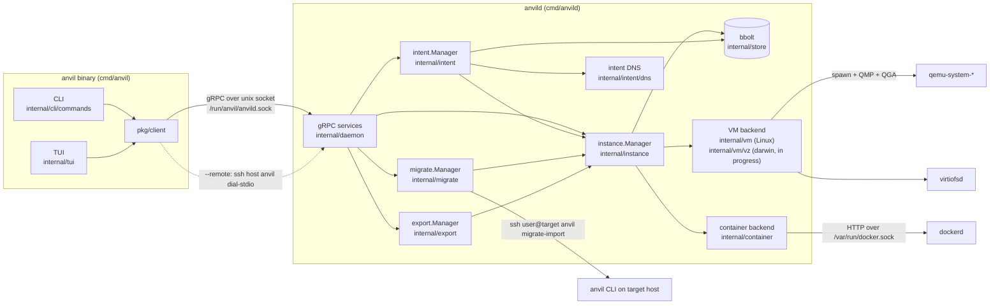
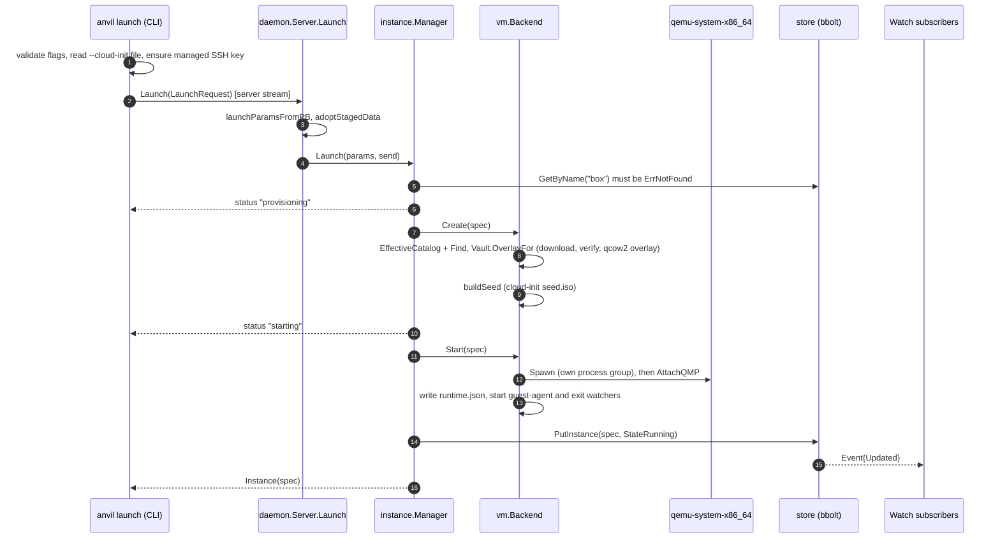

# Architecture

This document describes how Anvil is built: its components, how one request travels
through them, how state is stored, how concurrency and daemon restarts are handled, and
the design decisions behind it, with their trade-offs. Every statement points at the
code that implements it. The security side is covered separately in
[security.md](security.md).

## 1. Overview

Anvil manages two kinds of instances, QEMU virtual machines and Docker containers,
behind one gRPC API. A single long-running daemon, `anvild`, owns all state and all
business logic. The `anvil` binary is a client: a cobra CLI and a Bubble Tea TUI that
both build a request, send it to the daemon and render the reply.



## 2. Components

### 2.1 The `anvil` binary (CLI and TUI)

`cmd/anvil` builds the cobra tree from `internal/cli/commands/root.go`. Every command
calls `dial()` in the same file, which returns a `*client.Client` from `pkg/client`,
either over the local unix socket or over SSH when `--remote` (or `ANVIL_REMOTE`) is set.
`anvil tui` (`internal/tui`) uses the same client and the same RPCs.

The client keeps some work on its own side, because it depends on the user running it
rather than on the daemon:

- Reading local files named on the command line, such as `--cloud-init` and `--ssh-key`
  (`internal/cli/commands/launch.go`).
- The guest-access SSH keypair, generated on first use at
  `$XDG_CONFIG_HOME/anvil/ssh/id_ed25519` (`internal/sshkey/sshkey.go`). Its public half
  is added to every VM launch request.
- Running the real `ssh` or `docker` binaries for `shell`, `exec` and `transfer`
  (`internal/cli/commands/ssh.go`, `internal/tui/shell.go`), with a per-instance
  `known_hosts` file under the user cache directory.

### 2.2 `pkg/client`

`pkg/client/client.go` wraps one `grpc.ClientConn` and exposes every generated service
client (Instance, CloudInit, Mirror, Image, Intent, Host, Migrate, Export, Snapshot).
`Dial` connects to `unix://<socket>` with insecure transport credentials: there is no TLS
because the transport is a local socket.

`DialSSH` (`pkg/client/ssh.go`) runs `ssh -T -o BatchMode=yes <dest> anvil dial-stdio
--socket <path>` and wraps the child process's stdin and stdout in a `net.Conn`
(`cmdConn`). On the remote host, the hidden `dial-stdio` command
(`internal/cli/commands/dial_stdio.go`) copies stdio to and from the local unix socket.
gRPC then runs unchanged over that pipe. The client also knows how to reach guests
through the remote host: `jumpArgs` adds `ssh -J <remote>` and `DockerEnv` sets
`DOCKER_HOST=ssh://<remote>`.

### 2.3 `anvild`

`cmd/anvild/main.go` wires everything together at startup, in this order:

1. Create the runtime directories (`internal/config/paths.go`, `paths_linux.go`):
   `/run/anvil`, `/var/lib/anvil`, `/var/cache/anvil` and their subdirectories.
2. Open the bbolt database (`store.Open`).
3. Load the embedded image catalog (`data/distros`) and the image vault.
4. Build the VM backend (`newVMBackend`, chosen per platform) and the container backend.
5. Build `instance.Manager` with one backend per kind, then run `Manager.Reconcile`.
6. Build `intent.Manager`, run `ReconcileNetworks`, start the intent DNS server.
7. Start the optional mDNS announcer (`internal/discovery`, off with `ANVIL_MDNS=off`)
   and the optional Prometheus endpoint (`ANVIL_METRICS`).
8. Build the migrate and export managers.
9. Remove a stale socket, listen on `/run/anvil/anvild.sock`, `chmod 0660` it, register
   nine gRPC services and serve.
10. In the background: `Manager.Autostart` and `Manager.RunSnapshotScheduler`.

On `SIGINT`/`SIGTERM` the daemon calls `GracefulStop`, and falls back to a hard `Stop`
after 10 seconds (for example when a `logs --follow` stream is still open).

The gRPC service implementations live in `internal/daemon`, one `*_server.go` per area.
They convert between protobuf and domain types (`internal/daemon/convert.go`) and call a
manager. They hold no state of their own.

### 2.4 Backends

| Backend | Package | Talks to |
|---|---|---|
| QEMU VMs (Linux) | `internal/vm`, `internal/vm/qemu` | `qemu-system-*` processes over QMP and the QEMU guest agent, `qemu-img`, `virtiofsd`, Linux bridges and tap devices |
| Firecracker VMs (Linux) | `internal/vm` (`fc_*.go`), `internal/vm/firecracker` | `firecracker` (under `jailer` when installed) over its REST API, the guest agent over vsock, raw disks, taps on the intent bridge or `anvil-fc0` |
| Apple Virtualization.framework VMs (darwin) | `internal/vm/vz` | in progress, every method currently returns a "not implemented yet" error |
| Docker containers | `internal/container`, `internal/container/docker` | the Docker Engine HTTP API (`v1.41`) on `/var/run/docker.sock` |

Both Linux VM backends sit behind `vm.Hypervisors` (`internal/vm/hypervisors.go`), the one
`KindVM` backend the manager sees. It picks QEMU or Firecracker per instance from
`VMSpec.Hypervisor`.

`internal/container/backend.go` is a small dispatcher that picks an engine per instance
from `ContainerSpec.Engine`. Docker is the default. Podman is a recognised value, but
the `Podman` field is always `nil`, so a Podman request fails with "podman support isn't
implemented yet".

## 3. End-to-end request path: `anvil launch`

The example is `anvil launch --kind vm ubuntu-24.04 --name box`, a standalone VM.



Step by step:

1. **CLI** (`internal/cli/commands/launch.go`). Flags are checked locally (for example
   `--wait` and `--no-start` are exclusive). For a VM, `resolveSSHKeys` always includes
   the managed public key from `internal/sshkey`. The command builds an
   `anvilv1.LaunchRequest`, dials the daemon and calls the server-streaming `Launch` RPC.
2. **gRPC layer** (`internal/daemon/server.go`, `Server.Launch`). The request becomes
   `instance.LaunchParams`. `adoptStagedData` (`internal/daemon/staged_data.go`) moves
   folders uploaded by a migration into place; for an ordinary launch it does nothing. If
   `IntentName` is set, the call goes to `intent.Manager.Launch`, which allocates the
   intent network and the member address and then calls `instance.Manager.Launch`.
   Otherwise it goes straight to `instance.Manager.Launch`.
3. **Manager** (`internal/instance/manager.go`, `Launch`). It picks the backend for the
   kind, rejects a name that is already in the registry, and builds a `Spec` with a new
   ULID and `StateStarting`. It then calls `Backend.Create` and, unless `NoStart`,
   `Backend.Start`. If `Start` fails it calls `Backend.Delete` to roll back, so no
   resource is left untracked. Only after both succeed is the record written with
   `PutInstance`. If that write fails, the backend resources are deleted again.
4. **VM backend, Create** (`internal/vm/backend.go`). It resolves the image reference
   against the embedded catalog merged with every enabled VM mirror
   (`EffectiveCatalog`), prepares a QCOW2 overlay on top of the cached base image
   (`internal/vm/image/vault.go`, download and SHA256 check in `downloader.go`), and
   builds a cloud-init seed ISO (`buildSeed`). The user-data is merged with the SSH keys,
   virtiofs mounts, extra `/etc/hosts` entries and, unless `--no-guest-agent`, the
   `qemu-guest-agent` package.
5. **VM backend, Start**. A `starting` set under `Backend.mu` rejects a second
   concurrent `Start` for the same instance, and a VM that is already running is a
   no-op. KVM is used when `/dev/kvm` exists and the guest architecture matches the
   host. A standalone VM gets SLIRP networking with an SSH host-forward on a free port
   (`allocateFreePort`); an intent member gets a tap device on the intent's bridge
   (`Networker.Attach`). `virtiofsd` processes are started for mounts, then
   `qemu.Spawn` starts QEMU in its own process group and `AttachQMP` connects to its QMP
   socket. The PID and QMP socket path are saved in `runtime.json` for later recovery
   (section 8).
6. **Events**. `PutInstance` goes through `notifyingRegistry`
   (`internal/instance/events.go`), which publishes an `EventUpdated` to every `Watch`
   subscriber.
7. **Reply**. Progress travels back as `LaunchProgress` messages, each carrying exactly
   one of `status`, `instance` or `error`. With `--wait`, the final `instance` message is
   held back until `WaitReady` reports that cloud-init finished (default limit 15
   minutes). The CLI prints the stream with `streamProgress`, redrawing lines in place
   on a terminal.

Two properties follow from this order. While a launch is provisioning there is no
registry record, so `anvil list` and `Watch` do not show the instance until it is
running (or stopped, with `--no-start`). And if the daemon dies during a launch, the
instance directory under `/var/lib/anvil/instances/<id>` can be left behind without a
record.

## 4. The `instance.Backend` interface and optional capabilities

`internal/instance/backend.go` defines the core contract every backend implements:

```go
type Backend interface {
    Create(ctx, spec, progress) error
    Start(ctx, spec) error
    Stop(ctx, spec, force, timeout) error
    Delete(ctx, spec) error
    Status(ctx, spec) (State, error)
    Logs(ctx, spec, follow, tailLines, send) error
}
```

Every other operation is a separate, small interface. A backend implements it only if
it supports the operation:

| Interface | Methods | File | QEMU backend | Container backend |
|---|---|---|---|---|
| `Mounter` | `Mount`, `Umount` | `backend.go` | yes (`internal/vm/mounts.go`, virtiofs) | no |
| `PortForwarder` | `AddPort`, `RemovePort` | `backend.go` | yes (QMP `hostfwd_add`) | yes (recreates the container) |
| `Snapshotter` | `CreateSnapshot`, `RestoreSnapshot`, `DeleteSnapshot`, `ListSnapshots` | `backend.go` | yes (QCOW2 internal snapshots) | no |
| `Forker` | `Fork` | `backend.go` | yes (`internal/vm/fork_resize.go`) | no |
| `Reconciler` | `Reconcile` | `backend.go` | yes | no (see section 8) |
| `StatsProvider` | `Stats` | `backend.go` | yes (`internal/vm/stats.go`) | yes |
| `StatsSampler` | `SampleStats` | `backend.go` | yes | yes |
| `GuestInspector` | `GuestInfo`, `SetGuestChangeHook` | `backend.go` | yes (`internal/vm/guest.go`) | no |
| `ReadyWaiter` | `WaitReady` | `backend.go` | yes (cloud-init status) | no |
| `ExitNotifier` | `SetExitHook` | `backend.go` | yes (`internal/vm/exit.go`) | yes (`internal/container/docker_events.go`) |
| `Resizer` | `ResizeDisk` | `update.go` | yes | no |
| `LiveResizer` | `SetCPUsLive`, `SetMemoryLive` | `update.go` | yes (`internal/vm/hotplug.go`) | no |

`StatsSampler` serves the stats stream (`anvil stats`, the TUI's live view): a one-shot
`Stats` measures CPU and network rates over a 200 ms window, while each tick of a stream
takes its rates from the previous tick's counters, so it waits no window at all. A sample
from another process or container (a restart in between) isn't used: that tick measures
over the window again.

The `Manager` never branches on the instance kind to decide what is possible. It
looks up the backend for the kind and type-asserts the capability, for example in
`Manager.Mount`:

```go
mounter, ok := b.(Mounter)
if !ok {
    return fmt.Errorf("instance: %s instances don't support mounts", spec.Kind)
}
```

The same pattern appears in `snapshotter()`, `Fork`, `Stats`, `AddPort`/`RemovePort`,
`WaitReady` (where a missing `ReadyWaiter` means "ready as soon as it runs") and
`Update` (where a missing `LiveResizer` means "applies at the next start"). Hooks are
wired once in `NewManager`: `hookGuestChanges` and `hookExits` type-assert
`GuestInspector` and `ExitNotifier` on every backend.

The container dispatcher in `internal/container/backend.go` repeats the pattern one
level down: it forwards `AddPort`, `RemovePort` and `Stats` only if the chosen engine
implements them.

The trade-off: capability checks happen at run time, so a missing capability is a
gRPC error rather than a compile error. In return, adding a backend (such as `vz`)
only needs the core six methods to compile and run, and the daemon and CLI code stay
free of per-kind branches.

## 5. The bbolt store

`internal/store` keeps all registry state in one bbolt file, `/var/lib/anvil/anvil.db`
(`config.DBPath`), opened with mode `0600` and a 5 second lock timeout, so a second
daemon on the same file fails to start rather than corrupting it. Values are JSON.

| Bucket | Key | Value | File |
|---|---|---|---|
| `instances` | instance ID (ULID) | instance record: name, kind, state, labels, VM or container spec, autostart, restart policy, `user_stopped` | `bolt.go` |
| `instance_names` | instance name | instance ID | `bolt.go` |
| `intents` | intent ID | intent: name, members (instance ID, role, kind, IP), network (engine network name, bridge, subnet, gateway, Docker IP range) | `intents.go` |
| `intent_names` | intent name | intent ID | `intents.go` |
| `cloud_init_configs` | template name | user-data content and modification time | `cloudinit.go` |
| `mirrors` | mirror name | VM manifest (URL plus cached JSON) or container registry rewrite, priority, enabled flag | `mirrors.go` |
| `hosts` | host alias | SSH target `user@host[:port]`, optional identity path, `StrictHostKey` | `hosts.go` |
| `events` | big-endian sequence number | event log entry: time, instance ID and name, action, actor, message, error; newest 10000 kept | `events.go` |

Each instance and intent write updates the record and its name index in one bbolt
transaction. Reads always return a fresh copy decoded from JSON, so callers never share
memory with the database or with each other.

Large or binary state is kept on disk, not in bbolt:

| Path | Contents |
|---|---|
| `/var/lib/anvil/instances/<id>/` | `disk.qcow2`, `seed.iso`, `qmp.sock`, `qga.sock`, `fs-<tag>.sock`, `console.log`, `qemu.log`, `runtime.json` |
| `/var/cache/anvil/images/prepared/` | downloaded, checksum-verified base images, plus a SHA256 sidecar file |
| `/var/lib/anvil/.ssh/id_ed25519` | the daemon's migration SSH key |
| `/var/lib/anvil/migrate-known-hosts` | host keys of migration targets |
| `/var/lib/anvil/vm-mounts/`, `container-volumes/` | shared folders and volumes restored by a migration or import |
| `/var/cache/anvil/migrate-staging/`, `export-staging/` | temporary files during migration and import |

There is no `images` bucket, even though the comment on `config.DBPath` mentions one:
the VM image inventory is the vault directory itself, and container images are listed
from Docker.

## 6. The Watch event stream

`Watch` is a server-streaming RPC (`InstanceService.Watch` in
`api/proto/anvil/v1/anvil.proto`) used by `anvil watch` and by the TUI
(`internal/tui/messages.go`, `startWatch`).

Producers (`internal/instance/events.go`, `guest.go`, `exit.go`):

- `notifyingRegistry` wraps the registry. After every successful `PutInstance` it reads
  the record back and publishes `EventUpdated`; after `DeleteByID` it publishes
  `EventDeleted` with the old ID, name and kind. Because the event carries a fresh copy,
  subscribers never share memory with the writer.
- The guest-change hook publishes `EventUpdated` when the QEMU guest agent reports new
  IP addresses or cloud-init status, without a registry write.
- The exit hook writes the new state when an instance stops or starts outside Anvil,
  which in turn publishes an event.

Delivery (`broadcaster`): each subscriber gets a channel buffered to 256 events.
`publish` never blocks; if a subscriber's buffer is full, the event is dropped for that
subscriber and a log line is written. Events are therefore change hints, not a reliable
log. Clients that need exact state re-read it; the TUI reloads the active screen after a
burst of events.

`Server.Watch` (`internal/daemon/server.go`) subscribes before listing existing
instances when `include_existing` is set, so no change between the list and the
subscription is lost (a change may be seen twice instead).

`InstanceService.Events` is the persisted counterpart: the event log behind `anvil events`
(see `docs/lifecycle.md`). With `follow` it also subscribes before reading the stored
events, and skips live events whose sequence number was already sent.

## 7. Concurrency

**gRPC.** Each RPC runs in its own goroutine (grpc-go default). Long operations
(launch, fork, migrate, export, logs) are server streams, so the client sees progress
and cancellation propagates through the stream context.

**Parallel start and stop.** `Manager.Start` and `Manager.Stop` run
`forEachParallel`: at most `maxParallelOps = 4` instances at once, bounded by a
semaphore channel. Every instance is attempted even if one fails; errors are joined
with `errors.Join`. `Manager.Delete` is sequential.

**Locks.**

| Lock | Guards | File |
|---|---|---|
| `vm.Backend.mu` | `running` (ID to QEMU process), `starting`, `stopping`, `virtiofs`, exit hook | `internal/vm/backend.go` |
| `vm.Backend.guestMu` | guest-agent pollers and their last report | `internal/vm/backend.go` |
| `recentPortsMu` | ports handed out by `allocateFreePort` in the last minute, so VMs started in parallel never get the same SSH port | `internal/vm/backend.go` |
| `QMPClient.mu`, `writeMu` | pending QMP replies; serialized writes | `internal/vm/qemu/qmp.go` |
| `intent.Manager.mu` | the read-modify-write of an intent record in `Launch`, `Remove`, `Delete` | `internal/intent/manager.go` |
| `restartTracker.mu` | restart counters and timers | `internal/instance/restart.go` |
| `broadcaster.mu` | Watch subscribers | `internal/instance/events.go` |
| bbolt | one writer at a time, many readers | `internal/store` |

`intent.Manager.mu` is a single lock for all intents and is held for the whole member
launch, image download included. Two intent launches never run at the same time, even
for different intents. `instance.Manager` itself has no lock: protection against double
work comes from the backend (`starting` and `running` checks in the QEMU backend, and
Docker's own idempotent start). The duplicate-name check in `Manager.Launch` is a
read followed later by a write, with no lock in between.

**Background work in the daemon.**

- `Manager.RunSnapshotScheduler` (`internal/instance/schedule.go`) checks every 30
  seconds for running VMs whose snapshot schedule is due, takes an `auto-<timestamp>`
  snapshot and prunes older `auto-` snapshots beyond `keep`. Hand-made snapshots are
  never pruned. `LastRun` is written on a fresh copy of the record so a settings change
  made during the snapshot is not overwritten.
- Restart policies (`internal/instance/restart.go`). When an instance stops on its own,
  `maybeRestart` schedules a restart with exponential backoff from 1 second up to 1
  minute. `on-failure:N` gives up after N restarts that did not run for 10 minutes. An
  explicit `anvil stop` sets `UserStopped` and cancels any pending restart.
- The intent DNS server refreshes its zones every 30 seconds.
- The Docker backend follows Docker's event stream and reconnects with backoff from 1
  to 30 seconds.

## 8. Crash and restart recovery

At startup, before serving requests, `anvild` runs these steps in order
(`cmd/anvild/main.go`):

1. **`Manager.Reconcile`** (`internal/instance/manager.go`). For every record in
   `running` or `starting` state, it calls the backend's `Reconcile` if the backend
   implements `Reconciler`. The QEMU backend (`internal/vm/backend.go`, `Reconcile`)
   reads `runtime.json`, then `qemu.Attach` checks that the PID still exists and that its
   `/proc/<pid>/cmdline` contains `qemu-system` and the instance's disk path, which
   protects against a reused PID. On a match it reconnects QMP and restarts the
   guest-agent and exit watchers. A reattached process is not a child of the new daemon,
   so its exit is detected by polling the PID every 2 seconds, and its exit status is
   unknown and counted as clean. If the PID is gone, the record becomes `stopped`. If the
   process is alive but QMP does not answer, the record becomes `error`.
2. **`intent.Manager.ReconcileNetworks`** removes engine networks that look
   Anvil-created (name prefix `anvil-`) but belong to no intent in the store.
3. **Docker exit catch-up.** Every time the Docker event stream (re)connects,
   `reconcileExits` (`internal/container/docker_events.go`) inspects every container
   record in `running` state and reports the ones Docker shows as `exited` or `dead`.
   The container backend has no `Reconciler`; this catch-up covers the same need.
4. **`Manager.Autostart`** (after the gRPC server starts) starts every instance with
   `autostart` set that is `stopped` or `error` and was not stopped on purpose.

The packaged systemd unit (`packaging/common/anvild.service`) sets `Restart=on-failure`
and `KillMode=process`: QEMU and `virtiofsd` share the daemon's cgroup, but stopping or
restarting the service only signals anvild itself. After a daemon crash, restart or
upgrade, step 1 attaches to the QEMU processes that are still alive.

## 9. Platform backends

`newVMBackend` is defined twice, selected by build tags:

- `cmd/anvild/platform_linux.go` (`//go:build linux`) returns `vm.NewBackend`, the QEMU
  backend in `internal/vm`.
- `cmd/anvild/platform_darwin.go` (`//go:build darwin`) returns `vz.NewBackend`, the
  Apple Virtualization.framework backend in `internal/vm/vz`.

Exactly one is compiled in. Both must satisfy `VMBackend` in `cmd/anvild/main.go`:
`instance.Backend` plus the catalog listing, migration export and import interfaces. The
on-disk paths also differ per platform (`internal/config/paths_linux.go` uses
`/run/anvil`, `/var/lib/anvil`, `/var/cache/anvil`; `paths_darwin.go` uses
`/usr/local/var/...`).

The `vz` backend is in progress. It already has the full method set (core methods plus
port forwarding, snapshots and fork) so the darwin build compiles, but each method
returns `errNotImplemented`. The README presents Anvil as a Linux tool today.

## 10. Design decisions and trade-offs

**QEMU over QMP, no libvirt.** The daemon builds the QEMU command line itself
(`internal/vm/qemu/args.go`), spawns the process and drives it over QMP
(`internal/vm/qemu/qmp.go`) and the guest agent (`qga.go`).
Gains: one less daemon to install and configure, full control of features such as live
CPU and memory hotplug, live `hostfwd_add`, virtiofs hotplug and backup-job based live
fork, and a simple reattach model based on `runtime.json`.
Costs: Anvil owns process supervision, cleanup on every failure path (`unwind` in
`Start`) and QEMU version differences. Some live operations rely on HMP commands sent
through QMP (`human-monitor-command`), whose text output is parsed
(`isHostfwdRemoveSuccess`). Features libvirt provides for free, such as QEMU sandboxing
under separate users or SELinux/AppArmor labels, are not present.

**Docker HTTP API, no SDK.** `internal/container/docker/client.go` is a small client
over the Docker socket that pins API version `v1.41` and implements only the calls
Anvil needs.
Gains: no large dependency tree, and the exact wire behaviour is visible in one file.
Costs: every new Docker feature must be added by hand, and behaviour that the SDK hides
(for example that container create does not pull a missing image, handled in
`DockerBackend.Create`) has to be handled explicitly.

**SSH for cross-host work, no daemon-to-daemon gRPC.** Migration
(`internal/migrate`) runs `ssh user@target anvil migrate-import` and feeds a JSON
payload on stdin; the target's own CLI talks to the target's own daemon. `--remote`
works the same way through `anvil dial-stdio`.
Gains: no network listener, no certificates, no second trust system. Whatever SSH
access already exists decides who may reach a host.
Costs: each step is a separate process with text output to parse
(`MIGRATE_OK`/`MIGRATE_FAIL` lines), throughput depends on SSH, and the target needs
the `anvil` CLI on the SSH user's `PATH` and that user in the target's `anvil` group.

**Unix group access control.** The daemon listens only on a unix socket with mode
`0660`; membership of the group that owns it is the only authorisation check.
Gains: no accounts, passwords or tokens to manage, and remote access reuses SSH.
Costs: there is a single privilege level. Every member of the group can do everything
the daemon can do, including actions that are equivalent to root when the daemon has
Docker access. See [security.md](security.md).

**Capability interfaces instead of a fat interface.** Covered in section 4.

**Thin clients.** All business logic sits behind the gRPC boundary, so the CLI and TUI
cannot drift apart. The exception is guest access (`shell`, `exec`, `transfer`), which
runs `ssh` or `docker` from the client because it must use the client user's terminal
and key.

**bbolt, one file.** An embedded key-value store needs no server and gives
transactional writes of a record plus its name index. The cost is one writer at a time
and JSON values without schema migration tooling; the newer fields of the instance
record (`internal/store/bolt.go`) use `omitempty` or `omitzero`, so older records still decode.
