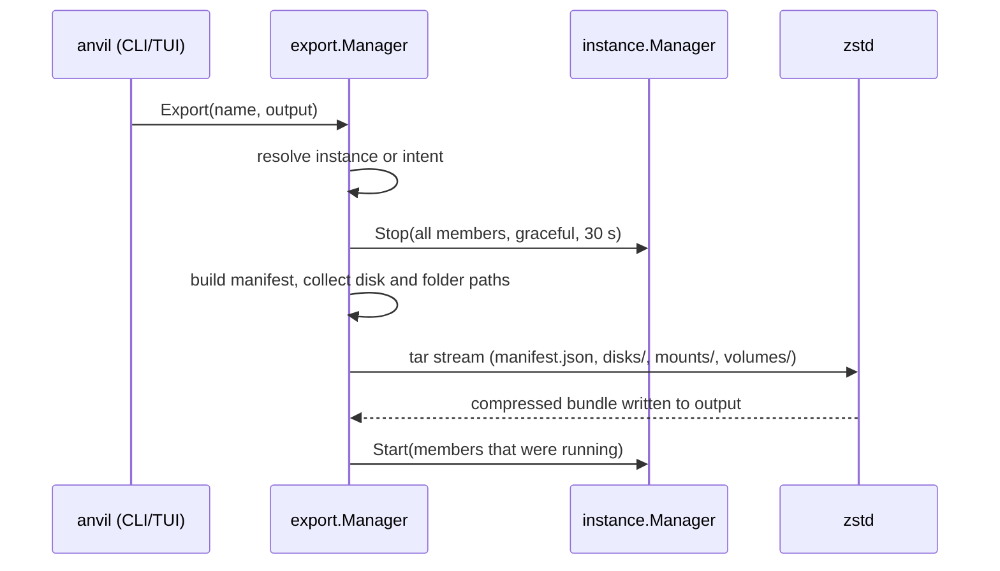
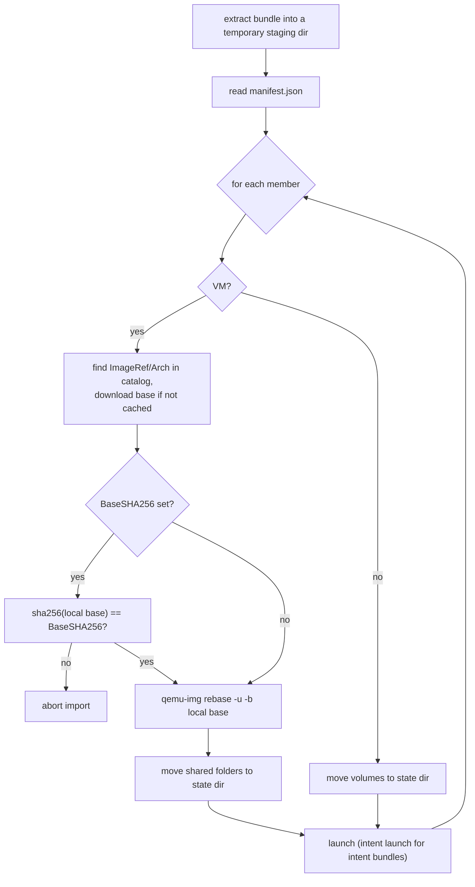

# Export and import

`anvil export` packs one instance, or a whole intent, into a single `tar.zst` file.
`anvil import` reads such a file and launches its instances again, on the same host or on
another one. Unlike `anvil migrate`, which streams to a target over SSH, a bundle is a
plain file that can be copied, archived, or imported later.

Code: `internal/export/` (`manager.go`, `manifest.go`, `archive.go`), the gRPC wrapper
`internal/daemon/export_server.go`, and the CLI in `internal/cli/commands/export.go`.

## Usage

```
anvil export <name|intent> -o <bundle.tar.zst>
anvil import <bundle.tar.zst> [--name <new-name>]
```

- `-o/--output` is required. Both paths are resolved on the daemon's host: the CLI
  passes them through `client.HostPath`, so with `--remote` they must be paths on the
  remote host, and the bundle is written and read by `anvild`, not by the CLI process.
- `<name>` is looked up as a single instance first, then as an intent.
- `--name` renames the imported intent, or the instance for a standalone bundle.

Both RPCs stream progress lines (`ExportProgress`, `ImportProgress`). On success the CLI
prints `Exported: <path>`, or `Imported: <id>` / `Imported: intent "<name>"` followed by
one `<role>: <id>` line per member.

## Export



### Resolution

`resolveExportTargets` tries `Info([name])` first. If an instance with that name exists
and carries an `intent` label, the export is refused with a hint to export the whole
intent instead: a single member exported alone would lose the network layout it depends
on. If no instance matches, the name is looked up as an intent, which must have at least
one member. The TUI's Intents screen sets `IsIntent` on the request, which skips the
instance lookup so a same-named instance cannot shadow the intent.

### Consistency: stop, copy, resume

Every member is stopped (graceful, 30 s timeout) before anything is read, and the
members that were running are started again afterwards, also when the export fails. The
resume runs on a context detached from the request, with its own 5-minute timeout, so a
cancelled export (Ctrl-C) does not leave instances stopped. A failure to resume is
reported as a progress warning, not as an error.

Stopping is a deliberate trade-off. A stopped VM's `disk.qcow2` is closed and consistent,
and a stopped container cannot write to its bind-mounted directories during the copy, so
the bundle is consistent across all members of an intent at once. The cost is downtime
for the whole duration of the copy and compression. No live path (like `anvil fork`'s
`blockdev-backup`) is used here.

### What travels

| Item | In the bundle | Notes |
|---|---|---|
| VM disk | the overlay `disk.qcow2`, copied byte for byte | not flattened; the base image is **not** included |
| VM base image | only its SHA-256 (`BaseSHA256`) | the import host must provide the same base |
| VM internal snapshots | yes, implicitly | they live inside `disk.qcow2`; live ones include RAM state |
| VM shared folders (`anvil mount`) | directory contents under `mounts/` | regular files and directories only |
| Container bind-mounted volumes | directory contents under `volumes/` | regular files and directories only |
| Container image | only the reference | pulled again on import |
| Container writable layer | no | only the spec and bind-mounted data travel |
| cloud-init | the resolved user-data text | a named library entry is inlined as content |
| CPUs, memory, disk size, SSH keys, ports | yes | |
| Intent name, subnet, gateway, Docker IP range | yes, for an intent bundle | members' role and static IP too |
| Snapshot schedule, autostart, restart policy, other labels | no | not part of the manifest |

The VM disk is added with `addFileToTar(tw, "disks/<id>.qcow2", v.DiskPath)`, i.e. the
whole overlay file. The VM backend also has an `ExportDiskDelta` method
(`qemu-img convert -B <base>`) that writes a compacted delta, but only `anvil migrate`
uses it; export copies the file as it is. Two consequences: the bundle contains the
internal snapshot table and any data those snapshots pin, and its size is the overlay's
file size before compression.

Bind-mounted directories are walked with `filepath.WalkDir` (`addDirToTar`). Symlinks,
sockets and device files are skipped silently. Ownership is stored by the tar header but
not restored on extraction (see below). A shared folder or volume whose host path is not
a directory readable by `anvild` is not archived; export prints
`warning: ... isn't a directory anvild can read, skipping its contents` and records the
mount with an empty `Archive`.

### Bundle layout

A bundle is a tar stream compressed by the external `zstd` binary (`zstd -q -c`), which
must be on `PATH` on both hosts. The archive layout:

```
manifest.json
disks/<instance-id>.qcow2          one per VM member
mounts/<instance-id>/<n>/...       contents of the VM's n-th shared folder
volumes/<instance-id>/<n>/...      contents of the container's n-th bind-mounted volume
```

`<instance-id>` is the exporting host's ULID, so paths never collide between members.
`<n>` is the mount's index in the instance's spec.

### Manifest

`manifest.json` is the JSON encoding of `export.Manifest` (`internal/export/manifest.go`).
The structs have no `json` tags, so keys are the Go field names (`IntentName`,
`Members`, ...), and there is no format version field. Compatibility with older bundles
relies on missing fields decoding to zero values (for example an empty `BaseSHA256`).

```
Manifest
  IntentName      string           empty for a standalone instance
  Network         *Network         intent bundles only
    Subnet, Gateway, DockerIPRange
  Members         []Member
    Name          string           instance name on the exporting host
    Kind          "vm" | "container"
    Role          string           intent bundles only (falls back to Name)
    StaticIP      string           VM in an intent with a network, CIDR form
    VM            *VM
      ImageRef, Arch, CPUs, MemoryMiB, DiskGiB
      CloudInitContent             resolved user-data text
      SSHPublicKeys  []string
      Ports          []PortMapping {HostPort, GuestPort, Protocol}
      DiskFile       string        "disks/<id>.qcow2"
      BaseSHA256     string        empty if the disk has no base image
      Mounts         []Mount       {GuestPath, Tag, ReadOnly, Archive}
    Container     *Container
      ImageRef, Env, Entrypoint, Cmd, Engine
      Volumes        []VolumeMount {ContainerPath, ReadOnly, Archive}
      Ports          []PortMapping
```

`Mount.Tag` is kept unchanged on purpose: the guest's `/etc/fstab` refers to the virtiofs
tag and travels inside the disk, so a renamed tag would break the mount in the guest.

## Import



### Extraction

The bundle is unpacked into a fresh directory under the export staging dir
(`config.ExportStagingDir()`, inside the cache dir), which is removed when the import
returns. `extractAll` in `archive.go` only materialises directories and regular files,
creates them with mode `0750`/the header's permission bits, and cleans every entry name
against `/` so an entry like `../../etc/x` cannot escape the staging dir. Paths read from
the manifest (`DiskFile`, `Archive`) are checked again with `hostpath.Under`. Ownership
from the tar headers is not applied: restored files belong to the daemon's user.

### Base image resolution

`PrepareImportedDisk` (`internal/vm/backend.go`) handles each VM disk:

1. Look up `ImageRef` and `Arch` in the **effective** catalog of the importing host (the
   built-in catalog plus enabled mirrors). An image that only exists through a mirror on
   the exporting host is not found unless the same mirror is added here.
2. `Vault.Ensure` returns the cached base image, downloading it first if needed.
3. If `BaseSHA256` is set, the local base image's SHA-256 must match it. `FileChecksum`
   reuses a `.sha256` sidecar file when it is not older than the image, otherwise it
   hashes the image and writes the sidecar. A mismatch aborts with
   `local base image ... differs from the one this bundle was made against`.
4. `qemu-img rebase -u -F qcow2 -b <local base> <disk>` rewrites the overlay's
   backing-file pointer, which still names a path on the exporting host.

A disk with no backing file at all (one adopted from a flattened migration) skips every
step: it holds all of its blocks itself, and giving it a base would make the blocks it
never wrote read the base's data instead of zeros.

The checksum is what makes step 4 safe. `rebase -u` (unsafe mode) only rewrites the
header and does not compare data, so an overlay rebased onto a *different* base would
read wrong data from every cluster it never wrote. The same catalog entry can point to a
newer upstream build over time, so matching by name is not enough. A bundle from an older
version, without `BaseSHA256`, skips the check and is rebased anyway.

The prepared disk is then passed to the normal launch as `SourceDiskPath`. The VM
backend's `Create` sees it and moves the file into the new instance directory instead of
creating an overlay (`adoptMigratedDisk`, the same path that `anvil migrate` uses).

A **Firecracker** member (`Hypervisor` in the manifest; empty means QEMU) travels as a
qcow2 too: at export its raw disk is converted next to the bundle, as a delta on the raw
copy of its base when that base is cached, flattened otherwise. On import step 4 rebases
onto this host's raw copy of the same base instead (`-F raw`), and `Create` converts the
result back to a raw disk. A standalone Firecracker member keeps its address, since the
guest's network config inside the disk names it. When it can't (`anvil import --name` of a
copy next to its original, another subnet, or a member exported out of an intent), it gets
a new address and a new seed, as a fork does, so cloud-init runs again in the guest.

### Shared folders and volumes

Archived folder contents are moved out of the staging dir to fixed locations in the
state dir:

- VM shared folder `n` to `<StateDir>/vm-mounts/<instance name>/<n>`;
- container volume `n` to `<StateDir>/container-volumes/<instance name>/<n>`.

The new mounts point there, not at the original host paths, which may not exist on the
importing host. A mount recorded with an empty `Archive` (unreadable at export time) is
dropped with a warning, both for VMs and for containers.

### Launch, names and networks

Each member becomes a regular `LaunchParams` and is launched through
`instance.Manager.Launch` (standalone bundle) or `intent.Manager.Launch` (intent bundle).
`NoStart` is not set, so every imported instance is started, whatever state it was in
when exported. Each instance gets a new ID, but keeps the MAC address recorded in the
manifest (`MACAddress`): no cloud-init seed is built for an imported disk, and the network
config already inside it matches on that address. Bundles from older versions have no
`MACAddress`, and their VMs get one derived from the new ID.

Names:

- standalone bundle: the instance name is `--name` if given, else the original name;
- intent bundle: `--name` renames the intent, and members with the default
  `<intent>-<role>` name follow it; other member names are kept;
- every name is checked before anything is extracted into place, and a name already in
  use fails the whole import. There is no automatic renaming.

Folder data is moved with `hostpath.MoveDir`, which refuses an existing destination, so
an import never merges into another instance's shared folders.

Intent networks: the intent is launched with a pinned network equal to the bundle's
`Subnet`, `Gateway` and `DockerIPRange`, and each VM member with its original
`StaticIP`. If the target intent does not exist yet, its bridge network is created with
exactly that subnet, without falling back to automatic allocation. If an intent with
that name already exists with a different subnet or gateway, the launch fails. Pinning
keeps addresses meaningful: other members, and the per-intent DNS, refer to the same IPs
as before.

## Integrity

- The only content check performed by anvil is the base image SHA-256 described above.
  The bundle has no per-file checksums, and the manifest has no signature.
- The integrity of the bundle stream itself relies on `zstd` decoding and tar framing:
  a truncated or corrupt bundle makes extraction fail, and the import stops before
  anything is launched.
- There is no authentication of the bundle's origin. A bundle can carry cloud-init
  user-data and a disk image that will be booted, so it should be treated with the same
  trust as any VM image.

## Limitations

- **Downtime.** All members are stopped for the whole export.
- **No partial-import rollback.** Members are launched one after another; if a later
  member fails, earlier ones stay launched and the intent exists with part of its
  members.
- **Bundle written in place.** The output file is created directly at the target path;
  a failed export leaves a partial file there.
- **Base image not bundled.** The importing host needs network access to the image
  source, or a cached identical base image.
- **Only regular files and directories** from shared folders and volumes; symlinks and
  special files are dropped, ownership is not restored.
- **Custom member names are kept on an intent rename**, so importing such a bundle next
  to the intent it was exported from fails on the name check.
- **Passthrough devices** travel as ids only: the imported VM fails to start where a
  device isn't on the new host, see [passthrough.md](passthrough.md).
- **Not exported:** snapshot schedule, autostart, restart policy, labels other than the
  role, the container's writable layer, and the intent's other settings.

## TUI

Instances screen (`internal/tui/instances.go`):

| Key | Action |
|---|---|
| `E` | export the selected instance; prompts for `Output path` (default `<name>.tar.zst`) |
| `i` | import a bundle; prompts for `Bundle path` and `Rename (optional)` |

Intents screen (`internal/tui/intents.go`):

| Key | Action |
|---|---|
| `E` | export the selected intent (sent with `IsIntent`, so a same-named instance cannot shadow it) |
| `I` | import a bundle; `Rename (optional)` renames the imported intent |

Progress lines from the stream are shown in place while the operation runs. Relative
paths typed in the TUI are resolved the same way as in the CLI (`client.HostPath`).
