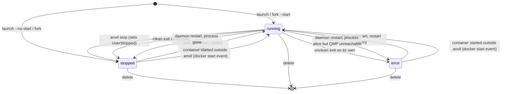

# Instance lifecycle

This document describes how anvild moves an instance (a QEMU VM or a Docker container)
through its states: what each command does to the registry record and to the backend,
how exits that anvil did not ask for are noticed, how restart policies and autostart
react to them, and what survives a daemon restart. Every statement points at the code
that implements it.

All of the logic lives in the daemon. `internal/instance/manager.go` (`Manager`) owns the
registry record and dispatches to one `instance.Backend` per kind
(`internal/instance/backend.go`): `internal/vm` for VMs and `internal/container` for
containers. The CLI and the TUI only send gRPC requests.

## States

`internal/instance/spec.go` defines seven states:

| State      | Meaning |
|------------|---------|
| `stopped`  | Provisioned, not running. |
| `starting` | Set in memory while `Launch`/`Fork` provision; never persisted by them. |
| `running`  | The backend process (QEMU) or container is up. |
| `stopping` | Defined and mapped in the API (`internal/daemon/convert.go`), never written by the manager. |
| `deleting` | Same as `stopping`; only `dockerStatusToState` returns it, for Docker's `removing`. |
| `deleted`  | Only on records left by older versions, whose delete kept the record. anvild removes them at startup. |
| `error`    | The instance stopped uncleanly, or could not be re-attached after a daemon restart. |

In practice the manager persists three of them: `stopped`, `running` and `error`. A launch writes the record only once `Create` (and `Start`, unless
`--no-start`) succeeded, so a failed launch leaves no record at all: `Manager.Launch`
deletes whatever `Create` provisioned before returning the error, rather than leave an
untracked disk or container behind.

Next to the state, two more fields drive automatic behaviour:

- `UserStopped` is set by an explicit stop and cleared by an explicit start. Autostart
  and the restart policy both leave an instance with `UserStopped` alone, so a deliberate
  `anvil stop` is never undone by the daemon.
- `RestartPolicy` and `Autostart`, described below.



## Create, start, stop, delete

### Launch (create)

`Manager.Launch` rejects a name that already exists in the registry, assigns a ULID, then
calls `Backend.Create` and, unless `NoStart`, `Backend.Start`.

- **VM** (`internal/vm/backend.go`, `Create`): resolves the image in the effective catalog
  (built-in plus mirrors), makes `disk.qcow2` as a qcow2 overlay on the prepared base
  image, then builds the NoCloud seed `seed.iso` (`buildSeed`). The seed merges, on top of
  the user's cloud-init, the SSH keys, the virtiofs mounts, the intent's extra hosts and,
  unless `--no-guest-agent`, the `qemu-guest-agent` package plus a `runcmd` that starts it.
  The cloud-init `instance-id` is `<id>-gen<Generation>`, so bumping `Generation` (done by
  mount changes) makes cloud-init treat the next boot as a new instance and re-run every
  module.
- **Container** (`internal/container/docker_backend.go`, `Create`): rewrites the image
  reference through any container mirror, pulls it if missing (the Docker create endpoint
  does not pull by itself), and creates a container named `anvil-<name>`. No Docker
  restart policy is set on the container: restarts are anvil's job (see below).

### Start

`Manager.Start` resolves every name and starts at most four instances in parallel
(`maxParallelOps`), trying all of them even if one fails and joining the errors. A
successful start sets `running`, clears `UserStopped` and resets the restart counter.

For a VM, `Backend.Start` is idempotent (an already running VM is a no-op) and refuses a
second concurrent start of the same instance. It allocates a free host port for the SSH
forward (SLIRP mode) or attaches a tap device to the intent bridge (bridge mode), starts
one `virtiofsd` per mount, spawns QEMU in its own process group, connects to QMP, and
writes `runtime.json` (PID, QMP socket, start time, and the boot-time memory and vCPU
limits that bound live resizing). It then starts the guest agent poller and a goroutine
that waits for the QEMU process to exit. If any step fails, everything set up so far is
undone (`unwind`).

### Stop and its escalation

`anvil stop [--force] [--timeout N]` (default 30 s, also the daemon's default when the
request carries no timeout) calls `Manager.Stop`, which cancels any pending policy restart,
stops the backend and records `stopped` with `UserStopped = true`.

For a VM, `vm.Backend.Stop` escalates in three steps, all bounded by `timeout`:

1. **Guest agent poweroff.** If the agent is connected and the stop is graceful, anvil
   sends `guest-shutdown` (mode `powerdown`) and waits up to `timeout` for QEMU to exit.
   This comes first because it does not depend on the guest reacting to an ACPI power
   button event, which minimal images often ignore.
2. **ACPI.** Otherwise, or if the agent step ran out of time, `qemu.Process.Stop` sends
   QMP `system_powerdown` and waits for whatever is left of `timeout`. When the agent step
   already used it up, ACPI still gets at least 5 s (`minACPITimeout`), as long as
   `timeout` itself is at least 5 s.
3. **Hard stop.** QMP `quit` with a 5 s bound, then `SIGKILL` to QEMU's whole process
   group (`internal/vm/qemu/process.go`, `kill`).

`--force` (or a zero timeout) skips steps 1 and 2. While a stop is in progress the
instance is marked in `Backend.stopping`, so the exit watcher does not report the exit as
something that happened on its own. After the process is gone, `releaseStopped` stops the
guest poller, kills the `virtiofsd` processes, detaches the tap device and removes
`runtime.json`.

For a container, `DockerBackend.Stop` calls Docker's `POST /containers/{id}/stop?t=N`
with `N = timeout` (0 with `--force`), after marking the container as an expected exit.

### Delete

`anvil delete <name>...` removes everything that belongs to the instance
(`Manager.Delete`, which calls `Backend.Delete`, then removes the record):

- a VM is force-stopped and its whole instance directory goes, disk, seed and snapshots
  included;
- a container is force-removed.

The cached base image the VM's disk was made from stays, since other VMs may sit on it
and a later launch of the same image then needs no download. `anvil delete --purge` also
removes that base image, when no other VM's disk still uses it as its backing file
(`Server.pruneBaseImage` in `internal/daemon/server.go`, the same check as
`anvil image delete`). A base outside the cache, one that came with a migrated disk, lives
in the instance directory and goes with it either way.

The daemon's `Delete` handler (`internal/daemon/server.go`) also removes the instance from
its intent, best effort.

## Exits that anvil did not ask for

Both backends implement `instance.ExitNotifier`. The manager installs `recordExit`
(`internal/instance/exit.go`) as the hook, which only applies a change that makes sense
for the current record: a stop only moves a `running` (or `starting`) record, a start only
moves a `stopped` or `error` one. Any other combination means anvil itself already
changed the record, and the event is ignored. This makes the hook safe against events
that arrive late or that anvil caused.

### VMs that die on their own

`watchExit` (`internal/vm/exit.go`) blocks on the QEMU process. When it exits and no
`Stop` is in progress (and no newer process replaced it), the new state comes from QEMU's
exit status: status 0, which QEMU uses after a guest poweroff or a QMP `quit`, gives
`stopped`; anything else (killed by a signal, OOM, crash) gives `error`. Resources are
released as in a normal stop, then the hook runs.

A VM re-attached after a daemon restart was not spawned by the current process, so its
exit status cannot be read: `ExitedCleanly` treats it as clean. Its liveness is polled
from `/proc` every 2 s instead of through `wait`.

### Containers changed outside anvil

`DockerBackend.SetExitHook` (`internal/container/docker_events.go`) follows Docker's event
stream filtered on container `die` and `start`:

- `die`: unless anvil stopped or removed that container in the last 2 minutes
  (`expectedExitWindow`, needed because Docker delivers events asynchronously), the exit
  code is mapped by `exitState`: 0, 130 (SIGINT) and 143 (SIGTERM, an outside
  `docker stop`) give `stopped`; anything else (crash, SIGKILL, OOM) gives `error`.
- `start`: reported as `running`. This also fires for anvil's own starts, which
  `recordExit` ignores because the record is already `running`.

The stream reconnects with exponential backoff (1 s up to 30 s). On every (re)connect,
`reconcileExits` first inspects every container whose record says `running` and reports
the ones Docker shows as `exited` or `dead`, which covers exits missed while dockerd or
the stream was down.

## Restart policies and autostart

The policy is set with `anvil launch --restart` or `anvil set --restart`
(`ParseRestartPolicy`):

| Policy           | Restarts after |
|------------------|----------------|
| `no` (default)   | never |
| `on-failure[:N]` | an exit recorded as `error`; at most `N` restarts in a row, `N = 0` or omitted means no limit |
| `always`         | an exit recorded as `stopped` or `error` |

Only exits reported through the hook trigger a restart, and never one with
`UserStopped`. `always` therefore also restarts a VM whose guest ran `poweroff`, or a
container stopped with `docker stop` outside anvil, since those are not anvil stops.

`maybeRestart` (`internal/instance/restart.go`) schedules the restart with exponential
backoff: 1 s, 2 s, 4 s, ... capped at 1 minute. The attempt counter resets when the
instance has run for more than 10 minutes since its last start (`restartStableAfter`), so
`on-failure:N` counts failures in a row, not failures over the instance's lifetime. An
explicit `anvil start` also resets it, and an explicit stop cancels any pending restart.
When the timer fires, `restartNow` re-reads the record and gives up if the instance
changed meanwhile (for example someone stopped or deleted it).

`--autostart` (or `anvil set --autostart`) makes `Manager.Autostart` start the instance
when anvild starts, if its record is `stopped` or `error` and `UserStopped` is false.

## Daemon restart

`cmd/anvild/main.go` runs, in this order:

1. `Manager.Reconcile`: for every record that says `running` or `starting`, a backend
   implementing `instance.Reconciler` re-derives the real state. Only the VM backend does.
   It reads `runtime.json`; if the PID is alive and its `/proc/<pid>/cmdline` contains
   `qemu-system` and this instance's disk path (a guard against PID reuse), it re-attaches,
   reconnects QMP and restarts the guest poller and exit watcher, giving `running`. A live
   process with an unreachable QMP socket gives `error`; no runtime file or no matching
   process gives `stopped`.
2. Intent network reconciliation.
3. `Manager.Autostart` and the snapshot scheduler, in the background, once the gRPC server
   is up.

Three consequences follow from the code:

- Container records are not reconciled at this step; the Docker event watcher's
  `reconcileExits` corrects records of containers that stopped while anvild was down.
  A container that was started outside anvil while anvild was down stays `stopped` in
  the registry until a later event changes it.
- Reconcile does not call the restart policy. An instance that died while anvild was down
  comes back only if it has autostart.
- On shutdown (SIGINT/SIGTERM) anvild stops serving gRPC but does not stop instances.
  QEMU runs in its own process group, so signals aimed at anvild's group do not reach it,
  and the shipped `packaging/common/anvild.service` sets `KillMode=process`, so systemd
  only stops anvild itself. A restart or package upgrade leaves VMs running, and the new
  daemon attaches to them again at Reconcile. At host shutdown they are still stopped.

## Waiting for first boot: `anvil wait` and `launch --wait`

`anvil wait <name> [--timeout 15m]` and `anvil launch --wait [--wait-timeout 15m]` both
end in `Manager.WaitReady`. The instance must be `running`. A container has no first-boot
step (its backend is not an `instance.ReadyWaiter`), so it is ready at once. With
`launch --wait` the daemon holds back the final "launched" event until the wait finishes
(`internal/daemon/server.go`); `--wait` and `--no-start` are mutually exclusive. If the
wait fails (cloud-init error, timeout) the error is reported, but the instance is kept.

For a VM, `vm.Backend.WaitReady` (`internal/vm/guest.go`) polls every 2 s, streams a
progress line when it changes, and returns when cloud-init is `done` or `disabled`, fails
on `error`, and also fails if QEMU exits meanwhile. Each poll (`probeGuest`) decides the
cloud-init status like this:

1. With the guest agent connected: run `cloud-init status` through `guest-exec` and parse
   its `status:` line (`running`/`not started`/`not run`, `done`/`degraded done`,
   `error`/`degraded error`, `disabled`). If that gives nothing (some distros block
   `guest-exec`, or the command broke mid-boot), read `/run/cloud-init/result.json`
   through `guest-file-read`: absent means still running, present with a non-empty
   `v1.errors` means `error`, otherwise `done`.
2. With no NoCloud seed (for example a migrated disk): `disabled`.
3. Otherwise, the last 256 KiB of the serial console log `console.log` are searched for
   cloud-init's final line, `Cloud-init v. <version> finished at`. A match means `done`.

Once a final status (`done`, `error`, `disabled`) is seen, it is kept and not asked again.
The background poller uses the same probe: every 3 s until the agent is connected and
cloud-init reached a final status, then every 30 s, only to follow IP address changes.

## `anvil set`: live resize

`anvil set <name> [--cpus N] [--memory MiB] [--disk GiB] [--autostart] [--restart P]`
calls `Manager.Update` (`internal/instance/update.go`). Only the flags given change, and
each applied change prints one note. CPU, memory and disk apply to VMs only; the
minimums are 1 vCPU and 128 MiB.

**CPU and memory.** On a stopped VM the new value is just recorded. On a running VM,
`internal/vm/hotplug.go` tries to apply it live; if it cannot, the value is still recorded
and the note says it applies at the next start (`ErrNeedsRestart`). Live changes are
possible because `Start` boots every x86_64 VM with headroom (`hotplugHeadroom`): vCPU
slots up to the host's CPU count (at most 64) and a virtio-mem device sized up to the
host's total memory. Other architectures get no headroom, so their changes always wait for
a restart.

- vCPUs are added with QMP `device_add` into free slots, and removed from the highest
  socket down (socket 0, the boot vCPU, always stays); removal waits up to 30 s for the
  guest to release them. With the guest agent, new vCPUs are also brought online through
  `guest-set-vcpus`, since some distros leave them offline.
- Memory changes the virtio-mem device's requested size, in 2 MiB blocks, between the
  memory the VM booted with and the host's total. Going below the boot memory needs a
  restart. Growing fails over to a restart if the guest has not taken the memory within
  30 s (for example a kernel without virtio-mem). Shrinking settles for what the guest
  managed to free once it stops releasing for 5 s, and the note says how much it still
  holds. With the guest agent, added memory blocks are also brought online.

**Disk.** `--disk` only grows and applies right away (`ResizeDisk`,
`internal/vm/fork_resize.go`). A stopped VM gets `qemu-img resize`; a running one gets
QMP `block_resize`. With the guest agent, anvil then runs cloud-init's own `growpart` and
`resizefs` modules in the guest, so the partition and filesystem grow at once; otherwise
the note says the filesystem grows at the next boot.

**Autostart and restart policy** are plain record updates and work for both kinds.

## The qemu-guest-agent

Unless `--no-guest-agent` is given, `buildSeed` adds `qemu-guest-agent` to cloud-init's
`packages` and a `runcmd` that enables and starts it (systemd, with an OpenRC fallback for
Alpine), because the udev rule that normally starts it only fires at boot. QEMU always
exposes a virtio-serial channel for it on `qga.sock` in the instance directory. Anvil
talks to the agent over that socket (`internal/vm/qemu/qga.go`), syncing each connection
with `guest-sync-delimited`.

What the agent provides, and what `--no-guest-agent` loses:

| Feature | With the agent | Without it |
|---------|----------------|------------|
| Stop | `guest-shutdown` first, then ACPI, then hard stop | ACPI, then hard stop |
| Guest IP addresses (`anvil info`, `list`, TUI) | from `guest-network-get-interfaces` | not reported |
| Cloud-init status, `anvil wait` | exact, including `error` | console log only: only `done` is detected, so a failed cloud-init still counts as done, and a missing final line waits until the timeout |
| Live vCPU/memory changes | new vCPUs and memory blocks are onlined | hotplug still happens; onlining is left to the guest |
| Live disk grow | partition and filesystem grow at once | at the next boot |
| Live fork (`anvil fork` of a running VM) | filesystems frozen around the copy, so it is filesystem-consistent | crash-consistent copy |
| Live `mount`/`umount` | done in place with `guest-exec` | the VM is reconfigured and restarted |

`anvil info` and the TUI show the agent as `connected`, `not connected`, or
`disabled (--no-guest-agent)`.

## The cloud-init library: `anvil cloud-init`

Saved cloud-init user-data documents live in the `cloud_init_configs` bucket of the bbolt
registry (`internal/store/cloudinit.go`), keyed by name, with their content and
modification time. The commands (`internal/cli/commands/cloudinit.go`):

| Command | Effect |
|---------|--------|
| `list` | List saved configs. |
| `new <name> [--from FILE\|-]` | Save a new config, empty `#cloud-config` by default. |
| `edit <name>` | Open it in `$EDITOR` and save the result. |
| `show <name>` | Print it. |
| `rename <old> <new>` | Rename it. |
| `delete <name>` | Delete it. |
| `import-repo <manifest-url> [--force]` | One-shot bulk copy of a repo's templates (see `docs/mirrors.md`). |

A VM references a saved config by name (`launch --cloud-init-name`) or carries ad hoc
content (`launch --cloud-init FILE`); exactly one of the two is set. A name is resolved
each time the seed is built: at create, at fork, and whenever a mount change rebuilds the
seed. Editing a saved config can therefore change what a later reseed of an existing VM
contains, and deleting or renaming one that a VM still references makes that reseed fail.
The server does not check references or validate the YAML on save.

## The event log: `anvil events`

The manager records one event per operation and per outside change
(`internal/instance/history.go`), in the `events` bbolt bucket (`internal/store/events.go`).
The newest 10000 are kept: each new event past that drops the oldest.

| Action | Recorded when |
|--------|---------------|
| `launch`, `fork` | an instance is created; a failure is recorded without an instance ID |
| `start`, `stop`, `delete` | through anvil, one event per instance; `start` also for a container started outside anvil |
| `autostart` | `Manager.Autostart` starts an instance when anvild starts |
| `exit` | an instance stops outside anvil (with the backend's reason), or is found stopped at Reconcile |
| `restart` | the restart policy restarts an instance, or gives up after `on-failure:N` |
| `update` | `anvil set`, with the applied changes |
| `mount`, `umount`, `port-add`, `port-remove` | the matching commands |
| `snapshot-create`, `snapshot-restore`, `snapshot-delete` | manual snapshots, and the scheduler's snapshots and prunes |

The actor is the caller's user name, read from the unix socket peer credentials by a gRPC
interceptor (`internal/daemon/events.go`), or `anvild` for what the daemon does on its own.
A failed operation is recorded with its error. Writing the event never fails the operation.

```
anvil events               # newest 100 events, all instances
anvil events web -n 0      # every stored event of web
anvil events -f            # then keep printing new events
anvil events -o json       # one InstanceEvent JSON object per event
```

## Where state lives on disk

The paths come from `internal/config` (`paths.go` plus `paths_linux.go`):

| Path | Content |
|------|---------|
| `/run/anvil/anvild.sock` | gRPC socket, mode 0660 for the `anvil` group. |
| `/var/lib/anvil/anvil.db` | bbolt registry: instances, intents, images, mirrors, hosts, cloud-init library. |
| `/var/lib/anvil/instances/<id>/` | One VM's files, see below. |
| `/var/lib/anvil/vm-mounts/<name>/<n>/` | A VM shared folder restored by a migration or import. |
| `/var/lib/anvil/container-volumes/<name>/<n>/` | A container volume restored by an import. |
| `/var/lib/anvil/.ssh/id_ed25519` | Key for outbound migration SSH. |
| `/var/lib/anvil/migrate-known-hosts` | known_hosts for migration targets. |
| `/var/lib/anvil/cloud-init/` | Created at startup, but the library itself is stored in `anvil.db`. |
| `/var/cache/anvil/images/prepared/` | Downloaded, checksum-verified base images. |
| `/var/cache/anvil/migrate-staging/`, `export-staging/` | Temporary data for migration and import. |

Inside a VM's instance directory:

| File | Written by |
|------|------------|
| `disk.qcow2` | `Create`: overlay on the base image (or the adopted migrated disk). |
| `base.qcow2` | Only for a migrated delta disk whose base image was sent along and is not cached locally (`adoptSentBase`). |
| `seed.iso` | `buildSeed`: the NoCloud seed. |
| `runtime.json` | `Start`: PID, QMP socket, start time, hotplug limits; removed on stop. Read by `Reconcile`. |
| `qmp.sock`, `qga.sock` | QEMU's QMP and guest agent sockets. |
| `console.log` | Serial console, append-only; what `anvil logs` streams for a VM. |
| `qemu.log` | QEMU's own stdout and stderr. |
| `fs-<tag>.sock`, `virtiofsd-<tag>.log` | One per shared folder. |

A container keeps no files of its own here: its state is the Docker container
`anvil-<name>` plus the registry record.
