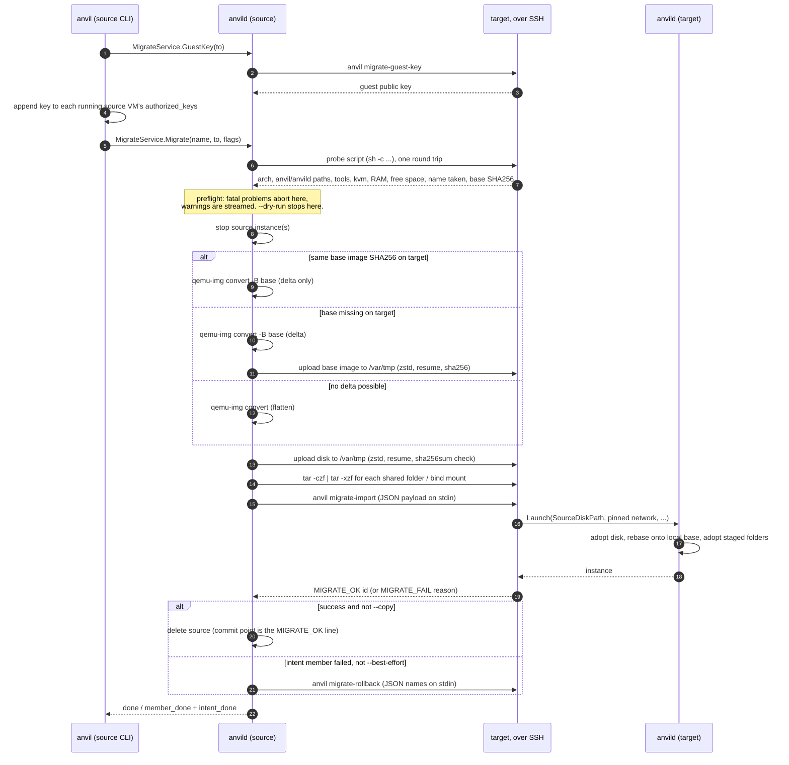

# Migration

`anvil migrate` moves a single instance, or a whole intent, from one anvil host to
another. It is a cold migration: the source is stopped, its data is copied, and the
target relaunches it from that copy. Memory state does not travel.

The design choice behind it is that hosts never talk to each other over gRPC. The source
`anvild` opens plain SSH connections to the target and runs the target's own local `anvil`
CLI there, which in turn talks to the target's `anvild` over its unix socket. Anvil
therefore never has to solve cross-host trust: whatever SSH access already exists between
the two machines is the whole trust model. The cost is that every remote step is a shell
command over SSH, so the protocol is a sequence of small, independently failing steps
rather than one transaction.

Code: `internal/migrate/` (manager, preflight, SSH, transfer), the hidden CLI commands
`internal/cli/commands/migrate_import.go` and `migrate_rollback.go` that run on the target,
and the gRPC side in `internal/daemon/migrate_server.go` and `host_server.go`.

## Commands

### Known hosts

`anvil host` keeps a list of named targets in the store, so `--to` can take a short alias
instead of `user@host[:port]` (`internal/cli/commands/host.go`). A saved host grants no
access by itself.

| Command | What it does |
|---|---|
| `anvil host add <alias> <user@host[:port]>` | Saves the target. `-i/--identity` sets a private key for this host, `--strict-host-key` turns off trust on first use (see below). Adding an existing alias replaces it. |
| `anvil host list` | Prints alias, target, identity and host key mode (`trust on first use` or `strict`). |
| `anvil host test <alias>` | Runs `command -v anvil && command -v anvild` on the target and reports both paths, or the error. |
| `anvil host discover [--timeout 3s]` | Sends one mDNS query for `_anvil._tcp` and lists the hosts that answer: name, address, SSH port. Nothing is saved. |
| `anvil host remove <alias>` | Deletes the saved entry. |

Discovery (`internal/discovery/mdns.go`) is only a convenience for filling in `host add`.
Every `anvild` answers mDNS queries unless started with `ANVIL_MDNS=off`
(`cmd/anvild/main.go`), and the address reported is the one the answer came from, since
that one is known to be reachable. The daemon caps the wait at 30 seconds
(`maxDiscoverTimeout` in `host_server.go`).

The TUI's Migration screen exposes the same operations (`internal/tui/migration.go`).

### Migrate

```
anvil migrate <name|intent> --to <alias|user@host[:port]> [--copy] [--dest-name N] [--dry-run] [--best-effort]
```

- `name` is looked up as an instance first and as an intent second
  (`Manager.Migrate` in `internal/migrate/manager.go`).
- An instance that belongs to an intent cannot be migrated on its own. The command fails
  and asks for the whole intent instead, because the member's network settings only make
  sense together with the intent's subnet.
- `--copy` keeps the source after a successful migration. Without it the source is deleted,
  but only after the target has confirmed the relaunch.
- `--dest-name` renames a single instance on the target. It is rejected for an intent.
- `--best-effort` only applies to an intent: members migrate independently and a failure
  does not undo the others. Without it an intent migration is all or nothing.
- `--dry-run` runs the target checks and prints the plan, then stops. Nothing is stopped
  and nothing is transferred.

Progress is streamed back as `MigrateProgress` events: free-form status lines, a final
`done` with the new instance ID, or for an intent one `member_done` per member followed
by an `intent_done` summary (`migrate_server.go`).

## SSH identity and host key trust

`anvild` runs as the unprivileged `anvil` user (`packaging/common/anvild.service`), so
the SSH connections are made by that user, not by whoever typed the command. Every `ssh`
call is built by `commonArgs` in `internal/migrate/ssh.go`:

- Identity: the host's `--identity` if set, otherwise anvild's own ed25519 key at
  `/var/lib/anvil/.ssh/id_ed25519`. It is created with `ssh-keygen` the first time it is
  needed (`EnsurePublicKey`). `anvil migrate-key` prints the public half, which has to be
  added to `authorized_keys` of the login user on the target.
- `BatchMode=yes`: SSH never prompts. A missing key or an unknown host fails immediately
  instead of hanging the daemon.
- Known hosts live in a separate file, `/var/lib/anvil/migrate-known-hosts`, not in any
  user's `~/.ssh/known_hosts`.
- `StrictHostKeyChecking=accept-new` by default: the first key seen for a host is
  accepted and recorded, and a later different key is refused. This is trust on first use
  (TOFU). It is convenient, but the very first connection is not protected against a
  machine in the middle.
- With `--strict-host-key` the option becomes `StrictHostKeyChecking=yes`: the host's key
  must already be in that file. Since `host add` on an existing alias replaces it, one
  way to get there is to connect once with TOFU, check the recorded key, then add the
  alias again with `--strict-host-key`.

`parseTarget` rejects a user or host starting with `-`, so a crafted target cannot be read
by `ssh` as an option.

On the target, the login user runs `anvil migrate-import`, which dials the target's
`anvild` socket. That user therefore needs the `anvil` CLI on `PATH` and membership of the
target's `anvil` group, the same requirement as any other local `anvil` command.

## Guest access keys

A migrated VM disk is relaunched without a cloud-init seed (see "Relaunch on the target").
The SSH key that the target's `anvil ssh`/`shell`/`exec` would use to log into the guest is
therefore never injected by cloud-init. To cover this, the CLI does one extra step before
the migration starts, unless `--dry-run` is set (`injectGuestKeys` in
`internal/cli/commands/migrate.go`):

1. It asks the source daemon for the target's guest key. The daemon runs
   `anvil migrate-guest-key` on the target over SSH, which prints the login user's
   default anvil guest key (`~/.config/anvil/ssh/id_ed25519.pub`, generated if missing,
   `internal/sshkey/sshkey.go`).
2. For every VM about to move (the instance, or every VM member of the intent), the CLI
   logs into the running guest with the local user's own key and appends that public key
   to `~/.ssh/authorized_keys`, skipping it if it is already there.

A VM that is not running is skipped with a warning, so its key has to be added by hand.
Containers are skipped. This step runs in the client rather than the daemon because the
guest login uses the invoking user's key, which the daemon does not have.

## Protocol, step by step



### 1. Resolve the target

`resolveTarget` looks `--to` up as a saved alias first, copying its identity and strict
flag, and otherwise parses it as a literal `user@host[:port]`.

### 2. Probe the target

`probeRemote` (`internal/migrate/transfer.go`) sends one shell script in one SSH round
trip. Each line reports its own result and the script ends in `exit 0`, so a missing tool
shows up as an absent field rather than a failed probe. Only an SSH failure is an error.
The script is wrapped in `sh -c` (`remoteSh`) so it runs the same whatever the remote
login shell is. It collects:

- `uname -m`, normalised to `x86_64`/`aarch64`
- paths of `anvil` and `anvild`
- presence of `zstd`, `sha256sum`, `docker`, `podman`, `tar`, `/dev/kvm`, and for a VM the
  matching `qemu-system-<arch>`
- `MemTotal` from `/proc/meminfo`
- free space (`df -Pk`) under `/var/tmp`, `/var/lib/anvil` and `/var/cache/anvil`
- whether `anvil info <dest-name>` succeeds, meaning the name is already taken
- for a VM, the target's SHA256 of the same base image, via `anvil image checksum <ref> --arch <arch>`

### 3. Preflight

`preflight` (`internal/migrate/preflight.go`) turns the probe into fatal problems and
warnings. All fatal problems are collected and reported together.

| Check | Fatal | Warning |
|---|---|---|
| `anvil` or `anvild` missing on the target | yes | |
| An instance with the destination name exists | yes (use `--dest-name`) | |
| Shared folders or bind mounts to send, but no `tar` on the target | yes | |
| VM: `qemu-system-<arch>` for the VM's arch missing | yes | |
| VM: target arch differs from the VM's arch | | runs under emulation, slow |
| VM: no `/dev/kvm` | | runs under emulation, slow |
| VM: VM memory larger than the target's total RAM | | yes |
| VM: not enough free space for the current disk file plus folder data in `/var/tmp`, `/var/lib/anvil` or `/var/cache/anvil` | yes | |
| VM: folders that travel | | they land under `/var/lib/anvil/vm-mounts` |
| VM: shared folders that are not readable directories | | they are not shared on the target |
| Container: engine (`docker`, or `podman`) missing | yes | |
| Container: target arch differs from this host's | | the image is re-pulled for the other arch |
| Container: directories that travel | | they land under `/var/lib/anvil/container-volumes` |
| Container: bind mounts that are not readable directories | | the target mounts the same host path instead |

The free space check is done twice. Before anything stops it uses the current overlay
file size as a lower bound, since the size of the exported disk is not known yet. After
the export, `buildVMPayload` checks again with the real file sizes (disk plus base image
if it has to travel) and aborts before uploading if the target is short. An unknown amount
of free space (`df` failed) is never reported as a shortfall.

For an intent, every member is checked before any member is stopped. Without
`--best-effort` the first fatal problem aborts the whole migration with nothing stopped.
With `--best-effort` the failing member is recorded and skipped, and the rest proceed.

`--dry-run` returns right after this step, so it reports exactly what a real run would
check, and nothing else.

### 4. Stop the source

The source is stopped gracefully with a 30 second timeout. A VM must be stopped so that
`qemu-img` can read a consistent disk. For an intent, all members that passed preflight
are stopped together.

### 5. Export the disk

The disk is written to the local staging directory `/var/cache/anvil/migrate-staging`
(`config.MigrateStagingDir`) as `<instance-id>.qcow2`, which is removed when the step
ends, successful or not.

Anvil VM disks are qcow2 overlays on a cached base cloud image. If the base is
already on the target, sending the full flattened disk would mostly resend bytes the
target already has. `exportDiskDelta` in `manager.go` therefore tries three cases, in
order:

1. **Target has the same base.** The source computes the SHA256 of its local base
   (`BaseImageChecksum`, which reads the overlay's backing file) and compares it with the
   probe result. The comparison is repeated with a fresh `anvil image checksum` on the
   target, because an earlier member of the same intent may have just delivered that base.
   On a match, `ExportDiskDelta` (`internal/vm/backend.go`) runs
   `qemu-img convert -O qcow2 -B <base> -F qcow2 <disk> <out>`, which writes only the
   clusters that differ from the base into a new overlay.
2. **Target lacks the base.** The delta is exported as above and the local base image file
   is sent as well, once.
3. **No delta possible** (the backend does not support it, the disk has no backing file,
   or the delta export fails). `ExportDisk` runs `qemu-img convert -O qcow2` with no
   backing file, flattening base and overlay into one standalone image.

The comparison is by content hash and not by image name, because two hosts can cache
different builds under the same distro name. Rebasing a delta onto a different base would
silently corrupt the guest filesystem, so a mismatch has to fall back to sending the base.

**Firecracker VMs** have a raw disk, but it travels the same way (`internal/vm/fc_transfer.go`):
flattened to qcow2, or as a qcow2 delta on top of the raw copy of the base
(`-B <base.raw> -F raw`). The raw copy is just the base qcow2's disk content, so the base
qcow2's checksum still identifies it, and the target rebuilds an identical raw copy from its
own base. The target's `Create` rebases a delta onto that copy and converts the result back
to a raw `disk.raw`. The payload carries the hypervisor, and for a standalone Firecracker VM
its address: the guest's network config inside the disk names it, and a migrated disk boots
without a new seed, so the target keeps the same address. When it can't (another
Firecracker VM there holds it, or it's outside the target's `ANVIL_FC_SUBNET`), the target
assigns a new one and boots the disk with a new seed, as `anvil fork` does, so cloud-init
runs again in the guest. The target needs `firecracker` and a kernel for that arch.
Preflight refuses, before any upload, a target whose anvil has no `--hypervisor`, with no
`firecracker` or `/dev/kvm`, or of another arch (no emulation). A missing QEMU doesn't
matter for a Firecracker VM.

### 6. Upload

`uploadDisk` in `transfer.go` copies the file to `/var/tmp` on the target:
`/var/tmp/anvil-migrate-<instance-id>.qcow2` for the disk and
`/var/tmp/anvil-migrate-base-<sha256>.qcow2` for a base image. `/var/tmp` is used rather
than `/tmp` because `/tmp` is often a small tmpfs, while `/var/tmp` is normally backed by
disk.

- **Transport.** The file is piped into `ssh ... 'sh -c "cat > path"'`. No `scp` or `rsync`
  is involved, so the target needs only a POSIX shell and `cat`.
- **Compression.** If both sides have `zstd`, the stream goes through `zstd -q -c -T0`
  locally and `zstd -q -d -c` remotely. qcow2 images, and especially their zero-filled
  regions, compress well, so this trades CPU for less network traffic. Without `zstd` on
  either side the raw file is sent.
- **Resume.** A broken connection is retried up to 4 attempts in total
  (`uploadAttempts`), waiting 1, 2, 3 seconds between them. Before each retry the remote
  file size is read with `stat`, and the local file is re-read from that offset and
  appended with `>>`. Because the remote end writes the decompressed output, its size is a
  valid offset into the uncompressed local file, and resuming works with or without
  `zstd`. A remote size larger than the local file resets the offset to 0. After the last
  failed attempt the partial remote file is deleted.
- **Verification.** If the target has `sha256sum`, the local file is hashed and compared
  with `sha256sum` of the remote file. A mismatch deletes the remote file and fails. Without
  `sha256sum` on the target this check is skipped, and the only protection left is SSH's
  own transport integrity plus the byte count check in `sendDisk`.
- **Progress.** A status line with percent and bytes is sent every 5 seconds.

### 7. Bind-mounted data

A VM's shared folders (`spec.VM.Mounts`) and a container's bind mounts
(`spec.Container.Volumes`) point at host directories that do not exist on the target.
`uploadDir` sends each readable directory as `tar -czf - -C <dir> .` piped into
`rm -rf <dest> && mkdir -p <dest> && tar -xzf - -C <dest>` on the target, with the
destination `/var/tmp/anvil-migrate-data-<instance-id>-<index>`. There is no resume or
checksum for this step, unlike the disk.

The handling of an unreadable path differs by kind, on purpose:

- **VM**: the mount is dropped from the payload. A virtiofs share with no directory behind
  it would stop the VM from starting, so losing the share is the lesser failure. The mount
  tag is kept, because the guest's `/etc/fstab` travelled inside the disk and refers to it
  (`adoptMountBookkeeping` in `internal/vm/mounts.go`).
- **Container**: the same host path is passed through unchanged, so the target mounts
  whatever is at that path on its own filesystem.

On the target, `adoptStagedData` (`internal/daemon/staged_data.go`) moves each staged
directory to `/var/lib/anvil/vm-mounts/<name>/<index>` or
`/var/lib/anvil/container-volumes/<name>/<index>` and points the mount there. Because
adopting deletes the source path, the daemon only accepts paths whose base name starts
with `anvil-migrate-data-` (`IsStagedDataPath`). Otherwise any caller of `Launch` could
ask the daemon to move an arbitrary directory.

For a container, nothing else is transferred: the target re-pulls `ImageRef` itself, and
anything written to the container's own writable layer, outside its bind mounts, stays on
the source. The payload also clears the container's network mode, so the target's own
launch path picks it (`buildContainerPayload`).

### 8. Relaunch on the target

The source builds a `payload.Payload` (`internal/migrate/payload/payload.go`): name, kind,
CPU, memory, image reference, staged file paths, base SHA256, mounts, ports, and for an
intent member the intent name, role, the intent's exact subnet/gateway/Docker IP range,
and the member's own static IP (VMs only). It runs `anvil migrate-import` on the target
with the JSON on stdin.

`migrate-import` (`internal/cli/commands/migrate_import.go`) turns the payload into an
ordinary `LaunchRequest` with `SourceDiskPath`, `SourceDiskBaseSha256`,
`SourceBaseImagePath`, `SourceDataPath` and the `Pinned*` network fields, sends it to the
local daemon, and prints `MIGRATE_OK <id>` or `MIGRATE_FAIL <reason>` as its last line.
Using plain marker lines on stdout keeps the protocol independent of SSH exit status
handling, and every other output line is relayed to the source as `target: ...` progress.

In the target daemon, `adoptMigratedDisk` (`internal/vm/backend.go`) replaces the normal
create path:

1. If the disk is a delta, the base is resolved first, before the disk is touched:
   - a locally cached base with the same SHA256 is used, and a base that was uploaded
     anyway is deleted;
   - otherwise the uploaded base is hashed again, checked against the expected SHA256, and
     moved into the image cache, or next to the disk as `base.qcow2` if a different image
     is already cached under that name (a cached base is never overwritten, since other
     disks depend on it);
   - with neither, the launch fails.
2. The disk is moved to `/var/lib/anvil/instances/<id>/disk.qcow2` (rename, or copy then
   delete across filesystems).
3. A delta is rebased onto the local base with `qemu-img rebase -u -F qcow2 -b <base>`.
   `-u` (unsafe mode) only rewrites the backing file pointer without comparing data, which
   is correct here only because the SHA256 check proved the two bases are identical.
4. No cloud-init seed is built. The guest already ran cloud-init on its first boot on the
   source, and everything it set up (users, keys, network config, fstab) is inside the
   disk. The network config matches the NIC by MAC address, so the payload carries the
   source's address (`VMSpec.MACAddress`) and the target VM keeps it, even though it gets
   a new instance ID. The guest agent poller reports cloud-init as disabled for such a VM
   (`internal/vm/guest.go`).

For an intent member, the target's intent manager uses the pinned subnet and gateway when
it creates the intent's network there, and the pinned static IP instead of the next free
address. If the target already has an intent of that name with a different subnet, the
launch fails rather than silently renumbering the member
(`ensureNetwork` in `internal/intent/manager.go`).

### 9. Commit or roll back

The commit point is the `MIGRATE_OK` line. Before it, the source is never deleted.

- **Single instance, not `--copy`**: the source is deleted. If that delete
  fails, the command reports that the target succeeded but the source is still there.
- **Intent, all members succeeded, not `--copy`**: each migrated source member is deleted
  one at a time, so one failure does not stop the rest, and is removed from the source
  intent's member list.
- **Intent, a member failed, not `--best-effort`**: the loop stops at the first failure,
  and the members that already landed are deleted on the target by running
  `anvil migrate-rollback` with a JSON array of their names on stdin
  (`internal/cli/commands/migrate_rollback.go`). That command force-deletes them through
  the target daemon. The source members are left in place. A failed rollback is
  only reported as a warning.
- **Intent, `--best-effort`**: failed members stay on the source, successful ones are
  deleted from the source (unless `--copy`). No rollback runs.

Rollback works by name because an intent migration always keeps each member's name on the
target (`--dest-name` is rejected for intents).

## Failure modes and leftover state

| Where it fails | Source | Target |
|---|---|---|
| SSH or probe fails, or preflight finds a fatal problem | untouched, still running | nothing written |
| Stopping the source fails | the instance (or some intent members) may be stopped | nothing written |
| Disk export fails | stopped; local staging file removed | nothing written |
| Not enough space after export | stopped | nothing written |
| Upload fails after all retries, or checksum mismatch | stopped | partial file deleted; files already staged for this instance (base image, earlier uploads) are deleted |
| Folder upload fails | stopped | staged disk and earlier staged folders deleted |
| `migrate-import` prints `MIGRATE_FAIL` or SSH drops during it | stopped | staged files are not cleaned up by the source; whatever the target daemon had already adopted, or launched, can remain |
| Intent member fails, not `--best-effort` | all members stopped, none deleted | already migrated members deleted by `migrate-rollback`, if that SSH call works |
| Source delete fails after success | still present, stopped | new instance running |

Two consequences are worth stating plainly:

- **The source is not restarted after a failure.** Every path after step 4 leaves the
  source stopped, so it has to be started again with `anvil start`. The same holds for
  `--copy`: the source copy is left stopped after a successful migration.
- **A lost connection during `migrate-import` is ambiguous.** The source cannot tell
  whether the target launched the instance. It keeps the source (which is the safe side of
  the commit point), so the worst outcome is two copies, never zero. For a single instance
  no rollback runs, so the target should be checked with `anvil --remote <host> list`
  before retrying.

## Limitations visible in the code

- Cold migration only: the guest is shut down, and its RAM state is lost.
- A container's writable layer does not travel, only its bind-mounted directories.
- A container intent member gets whatever address Docker assigns on the target. Only VM
  members carry a pinned static IP.
- A migrated VM never runs cloud-init again, so settings that came from cloud-init on the
  source (for example a static network config) are the ones in effect on the target.
