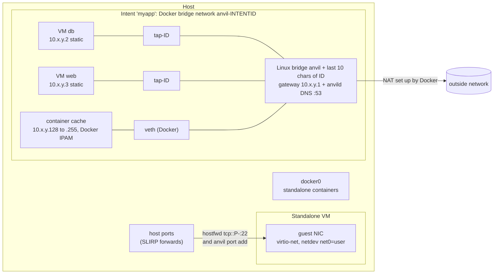

# Networking

Anvil has two network modes for VMs and reuses Docker's own networking for containers.
Which one an instance gets depends on a single question: does it belong to an intent with
a shared network?

| Instance | Network | How it is reached from the host |
|---|---|---|
| Standalone VM | QEMU user-mode network (SLIRP) | SSH and published ports forwarded to host ports |
| Standalone container | Docker's default network | ports published by Docker |
| Intent member, VM | tap device on the intent's Linux bridge, static IP | directly at its own IP |
| Intent member, container | the intent's Docker bridge network | directly at its own IP, or published ports |

The VM mode is stored in `VMSpec.NetworkMode` as `"slirp"` or `"bridge"`
(`internal/instance/spec.go`). Name resolution inside an intent is covered separately in
[intent-dns.md](intent-dns.md).



## Standalone VMs: SLIRP

A VM that is not part of an intent gets QEMU's user-mode network stack
(`buildNetdev` in `internal/vm/qemu/args.go`):

```
-netdev user,id=net0,hostfwd=tcp::<ssh-port>-:22[,hostfwd=...]
-device virtio-net-pci,netdev=net0
```

No `net=` option is passed, so the guest sees QEMU's default user-mode addressing and its
built-in DHCP server. SLIRP implements TCP/IP inside the QEMU process and turns the guest's
connections into ordinary sockets on the host. That is the reason it is the default:

- it needs no privileges, no tap device, no bridge and no firewall rules;
- the guest can reach whatever the host can reach;
- nothing can reach the guest except through an explicit forward.

The trade-offs are throughput (every packet goes through a user-space TCP stack), no
inbound connections without a forward, and no direct guest-to-guest traffic. Two
standalone VMs cannot talk to each other except through forwarded host ports. Intents
exist for that case.

### The SSH forward

On every start, `Backend.Start` (`internal/vm/backend.go`) picks a free host port with
`allocateFreePort` and forwards it to guest port 22. The port is stored as `VMSpec.SSHPort`
and is what `anvil shell`/`exec`/`transfer` connect to, as `localhost:<port>`
(`resolveSSHTarget` in `internal/cli/commands/ssh.go`). The port changes across restarts.

`allocateFreePort` binds `127.0.0.1:0`, reads the port the kernel assigned, and closes the
socket. That leaves a short window in which another process could take the port before
QEMU binds it. To keep VMs started in parallel from receiving the same port, ports handed
out in the last minute are remembered and skipped (`recentPorts`, 16 tries).

The `hostfwd` rule is written with an empty host address (`tcp::<port>-:22`), which QEMU
binds on every host address, not only on loopback.

### Port forwards: `anvil port`

```
anvil port add <name> <host>:<guest>[/tcp|udp]
anvil port remove <name> <host>[/tcp|udp]
anvil port list <name>
```

The CLI lives in `internal/cli/commands/port.go`. Forwards are optional backend
capabilities (`PortForwarder` in `internal/instance`), so the daemon calls whichever
backend owns the instance:

- **SLIRP VM.** If the VM is running, the forward is applied live through QMP with the
  human monitor commands `hostfwd_add net0 tcp::<host>-:<guest>` and
  `hostfwd_remove net0 tcp::<host>` (`internal/vm/qemu/qmp.go`). The netdev always has the
  fixed id `net0` so these commands have a stable target. The forward is also stored in
  `VMSpec.Ports`, so the next start passes it as a `hostfwd=` option. No restart is needed.
  Ports can also be set at launch with `--publish`.
- **Bridged VM.** Rejected: the VM has its own address on the intent network, so there is
  nothing to forward. `anvil launch` rejects `--publish` for a VM joining an intent for the
  same reason (`internal/cli/commands/launch.go`).
- **Container.** Docker cannot change port bindings on an existing container, so
  `DockerBackend.AddPort`/`RemovePort` update the spec and recreate the container: stop,
  remove, create with the new `PortBindings`, and start again if it was running
  (`internal/container/docker_backend.go`).

## Standalone Firecracker VMs

Firecracker has no SLIRP, so a standalone `--hypervisor firecracker` VM gets a tap on
`anvil-fc0`, a bridge anvild creates on the first such start (`10.254.254.0/24`, or the
/24 in `ANVIL_FC_SUBNET` from anvild's environment when that collides with a host network).

- **Address.** A free static address from the subnet, picked at create time and written
  into the seed's network-config, so the guest keeps it across restarts.
- **Outbound.** Masquerade in anvil's own nftables table (`table ip anvil`), plus rules in
  Docker's `DOCKER-USER` chain when Docker is installed, since Docker's FORWARD policy drops
  everything it doesn't know. Traffic towards Docker's own bridges (`docker+`, `br-+`) goes
  back to Docker's chains, which keep container and intent networks isolated. anvild turns
  on `net.ipv4.ip_forward` on the first standalone start. The table and rules are
  reapplied on every start, so a firewall reload that flushed them heals.
- **Inbound.** Nothing is routed into the subnet from outside except replies: published
  ports go through anvild's proxy below.
- **DNS.** anvild answers on the bridge gateway and forwards to the host's resolvers, the
  same server intent networks use.
- **SSH and `anvil port`.** A TCP/UDP proxy inside anvild listens on the host port (all
  interfaces, like SLIRP's hostfwd) and forwards to the guest, so `anvil shell`,
  `--publish` and `anvil port` work the same as for a QEMU VM. After an anvild restart the
  proxies come back on the same ports.

A Firecracker VM in an intent plugs its tap into the intent bridge like a QEMU VM does.


## Ephemeral clones

Clones of one warm snapshot (`anvil launch --ephemeral`, `anvil matrix`) all restore with
the same MAC and address, so each runs in its own network namespace
(`/run/netns/anvil-eph-<id>`) with the same layout inside: the guest is `10.200.0.2`
behind `tap0` (`10.200.0.1/30`), its gateway and DNS server.

- **Link.** A veth pair joins the netns to the host, on its own /30 from `10.253.0.0/16`
  (or the subnet in `ANVIL_EPH_SUBNET` from anvild's environment). The host end is named
  `anve<hash>`.
- **Outbound.** The netns masquerades the guest behind its end of the link, and the host
  masquerades the link (`table ip anvil-eph`), with the same `DOCKER-USER` rules as above.
  Clones can't reach each other, `anvil-fc0`, Docker's bridges or the host itself, apart
  from DNS.
- **Inbound.** Nothing, only replies.
- **DNS.** The netns forwards `10.200.0.1:53` to the host end of the link, where anvild
  answers like on `anvil-fc0`.
- **Privileges.** Creating a netns needs `CAP_SYS_ADMIN`, which anvild doesn't have, so the
  root helper `anvild devhelper` builds it (`internal/hostdev/netns_linux.go`); anvild only
  sets the host end's address and the host table (`internal/vm/fc_clonenet.go`).
- **Cleanup.** Clones live only in anvild's memory: on start anvild removes every
  `anvil-eph-*` netns it finds.
## Containers

Containers are created through Docker's HTTP API (`internal/container/docker/client.go`).
A standalone container leaves `HostConfig.NetworkMode` empty, so Docker puts it on its
default network, and published ports become `PortBindings` (`<guest>/<proto>` to
`<host>`). Anvil does not add any networking of its own for this case: it is plain Docker
behaviour.

## Intent networks

An intent is a group of VMs and containers that should see each other as if they were on
one LAN. Each intent with a network gets a dedicated /24, one Linux bridge, and a DNS zone.

### Who creates the bridge

The bridge is created through Docker, even for an intent that has only VMs
(`ensureNetwork` in `internal/intent/manager.go`, `DockerNetworker` in
`internal/container/docker_networker.go`). The request is a normal Docker bridge network:

```
POST /networks/create
  Name:   anvil-<intent ID>
  Driver: bridge
  Options: com.docker.network.bridge.name = anvil<last 10 chars of intent ID>
  IPAM:   Subnet 10.x.y.0/24, Gateway 10.x.y.1, IPRange 10.x.y.128/25
```

Fixing the Linux interface name with `com.docker.network.bridge.name` is what lets VMs
join: Docker's network is a real kernel bridge with a known name, so QEMU tap devices can
be attached to it next to Docker's own veth pairs. The result is one L2 segment in which a
VM and a container exchange frames directly, with no routing between them. Docker also
assigns the gateway address to the bridge and sets up outbound NAT for the subnet, so
Anvil does not have to manage those rules itself. The cost is a hard dependency: without a
reachable Docker daemon, creating an intent network fails.

The interface name uses the last 10 characters of the intent's ULID because Linux limits
interface names to 15 characters, and the end of a ULID is its random part.

Networks whose name starts with `anvil-` but match no stored intent are removed at daemon
startup (`ReconcileNetworks`), so a crash between creating a network and saving the intent
does not leak bridges. A new intent whose first member fails to launch also removes its
fresh network right away.

### IPAM

Address planning is in `internal/intent/ipam/ipam.go`. The /24 is split in two, so that
Anvil and Docker never hand out the same address without having to coordinate:

| Range | Owner |
|---|---|
| `.1` | gateway, on the bridge itself |
| `.2` to `.127` | static VM addresses, chosen by Anvil (126 slots) |
| `.128/25` | Docker's IPAM, for containers |

- **Subnet.** `AllocateSubnet(intentID, attempt)` hashes `"<intentID>/<attempt>"` with
  SHA256 and uses the first two bytes as `x` and `y` in `10.x.y.0/24`. The choice is
  deterministic, so no allocation table has to be stored, and spread over 65,536 possible
  subnets, so two intents rarely pick the same one. When Docker refuses the network (for
  example because the subnet overlaps an existing one), `ensureNetwork` retries with the
  next attempt number, up to 5 times. Overlap with networks that Docker does not know about
  (a LAN or VPN in `10.0.0.0/8`) is not checked.
- **VM addresses.** `nextVMAddress` collects the IPs of the intent's VM members, marks
  their indices as used (`UsedVMIndices`), and takes the lowest free one
  (`NextFreeVMIndex`, `VMAddress`), so addresses freed by removed members are reused. The
  result is in CIDR form, for example `10.x.y.2/24`.
- **Container addresses.** Docker picks them from `.128/25`. After launch, Anvil reads the
  address back from Docker (`ContainerAddress`) and records it on the intent member.

### How a VM joins the bridge

For a VM member, the intent manager sets `NetworkMode = "bridge"`, the bridge name, the
static IP, the gateway, and the gateway as DNS server with `<intent>.anvil` as search
domain. On start, the VM backend (`internal/vm/backend.go`):

1. Creates a persistent tap device `tap-<last 10 chars of instance ID>` through netlink,
   attaches it to the bridge and brings it up (`LinuxBridge.Attach` in
   `internal/vm/network/bridge.go`). The daemon runs unprivileged, so this relies on
   `CAP_NET_ADMIN` and access to `/dev/net/tun`, granted in
   `packaging/common/anvild.service`.
2. Starts QEMU with `-netdev tap,id=net0,ifname=<tap>,script=no,downscript=no` and a
   virtio NIC with a fixed MAC. `script=no` means QEMU does not try to configure the tap
   itself; it only opens the device Anvil prepared.
3. The MAC is `52:54:00` followed by the first three bytes of SHA256 of the instance ID
   (`macFromInstanceID`). It is stable across restarts, which matters for the next step.

The guest address is not given by DHCP. The cloud-init seed carries a network-config v2
document (`bridgeNetworkConfig`) that matches the NIC by that MAC and sets the static
address, `gateway4`, nameservers and search domain. Static addresses mean the IP is
known before the guest boots, so it can be written into other members' configuration and
DNS without waiting for the guest. The tap device is deleted when the VM stops or exits
(`internal/vm/exit.go`).

### How a container joins

For a container member, the intent manager sets `NetworkMode` to the intent's Docker
network name, adds the role as a network alias (so Docker's embedded DNS resolves it), and
sets the gateway as DNS server with the intent's search domain. Port publishing still
works for containers on an intent network.

### Static host entries

Members also get static host entries at launch, as a fallback next to DNS:

- a new VM gets one `/etc/hosts` line per member that already has an address, added by
  idempotent `bootcmd` lines in its cloud-init (`mergeExtraHosts`);
- a new container gets Docker `ExtraHosts` for VM members only, since container peers are
  already resolved by Docker through their aliases (`vmHostsFor`).

These entries are a snapshot taken at launch, so they do not include members added later.
The DNS server described in [intent-dns.md](intent-dns.md) covers that case.

### Migration

When a whole intent is migrated, the target recreates the network with the same subnet,
gateway and Docker range, and each VM member keeps its static IP (`PinnedNetwork` and
`PinnedStaticIP` in the launch request). See [migration.md](migration.md).

### Forks

A forked VM always starts as a standalone SLIRP VM: `cloneVMSpecForFork`
(`internal/instance/manager.go`) clears the bridge, static IP, gateway, host entries and
DNS settings, so a fork never takes over the address of its source.

## Guest IP discovery

Anvil never needs the guest to report its address in order to reach it: a SLIRP VM is
reached through its forwarded port and a bridged VM through the static IP Anvil assigned.
The addresses shown by `anvil info` and the TUI come from `qemu-guest-agent` and are for
display only.

- Unless the VM is launched with `--no-guest-agent`, cloud-init installs the
  `qemu-guest-agent` package and starts it (`mergeGuestAgent` in `internal/vm/backend.go`).
- QEMU exposes the agent on a virtio-serial port backed by a unix socket,
  `qga.sock` in the instance directory (`internal/vm/qemu/args.go`).
- A poller per running VM (`watchGuest` in `internal/vm/guest.go`) calls the agent's
  network interface query every 3 seconds until cloud-init has finished, then every 30
  seconds, only to follow address changes. Loopback and link-local addresses are dropped,
  and the rest are kept in CIDR form.
- A change in the report is published as an instance update event, so clients watching
  instances, such as the TUI, see it (`hookGuestChanges` in
  `internal/instance/guest.go`).
  The report is discarded when the VM stops.

For a SLIRP VM the reported address is the private user-mode one, which is not reachable
from the host. This is one more reason addressing does not depend on the agent.

## Traffic counters

`anvil stats` reads a bridged VM's network throughput from its tap device's kernel
counters (`LinuxBridge.Stats`). A SLIRP VM has no host-side interface to read, so no
network numbers are sampled for it (`internal/vm/stats.go`).
