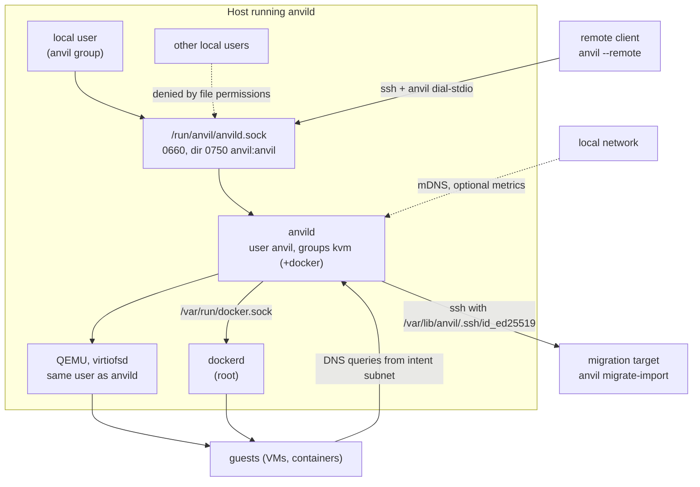

# Security model

This document describes who Anvil trusts, where the trust boundaries are, what an
attacker at each boundary can and cannot do, and which threats are out of scope. It is
derived from the code; file paths point at the implementation. The overall design is
in [architecture.md](architecture.md).

## 1. Summary

- Anvil has one privilege level. Any local user who can open the daemon's unix socket
  can use every RPC. There are no accounts, roles, passwords or tokens.
- When the daemon can reach Docker, that privilege level is equivalent to root on the
  host (section 4).
- Everything that crosses hosts (`--remote`, migration) uses the system `ssh` client.
  Anvil never listens on a network port for its API and adds no trust of its own on top
  of SSH.
- Three optional network-facing services exist: the per-intent DNS server, the mDNS
  announcer and the Prometheus endpoint. None of them accept commands.

## 2. Assets

- Host integrity (root on the machine running `anvild`).
- Guest VMs and containers: their disks, memory and running services.
- Secrets on disk: the daemon's migration SSH key, each user's guest-access SSH key,
  cloud-init user-data (which can contain passwords or tokens), the bbolt registry.
- Remote hosts reachable with the migration key.

## 3. Trust boundaries

### 3.1 Local API: unix socket and the `anvil` group

- The daemon listens only on `/run/anvil/anvild.sock` (`config.SocketPath`). After
  `net.Listen` it calls `os.Chmod(socket, 0o660)` and ignores a failure
  (`cmd/anvild/main.go`). The socket's group is the daemon's primary group.
- The packaged tmpfiles rule creates `/run/anvil` as `0750 anvil:anvil`
  (`packaging/common/anvil.tmpfiles`), so a user must be in the `anvil` group both to
  enter the directory and to write to the socket.
- gRPC runs with insecure transport credentials on both ends (`pkg/client/client.go`).
  The daemon does not read peer credentials (`SO_PEERCRED`) and has no per-RPC
  authorisation. File permissions are the only check.
- When `anvild` is started by hand as root (the README quick start), the socket belongs
  to root's group, so only root can use it.

Consequence: adding a user to the `anvil` group grants every operation in
`api/proto/anvil/v1/anvil.proto`, including deleting other users' instances, reading
their cloud-init templates and triggering migrations.

### 3.2 The daemon user

The packaged unit (`packaging/common/anvild.service`) runs `anvild` as the system user
`anvil`, not root, with:

- `SupplementaryGroups=kvm` and `DeviceAllow=` `rwm` for `/dev/kvm`, `/dev/net/tun` and
  `/dev/userfaultfd` (`m` lets the jailer create them inside its chroots).
- `AmbientCapabilities=CAP_NET_ADMIN CAP_NET_BIND_SERVICE`: bridges and tap devices, and
  the intent DNS server on port 53. Ambient capabilities are passed on to every program the
  daemon executes (QEMU, `virtiofsd`, `qemu-img`, `nft`, ...).
- A root `ExecStartPre=+` (`packaging/common/prepare-jailer.sh`) that copies Firecracker's
  `jailer` to `/var/lib/anvil-jailer/jailer`, runnable only by the `anvil` user, with
  `CAP_SYS_ADMIN CAP_SYS_CHROOT CAP_MKNOD CAP_CHOWN CAP_SETUID CAP_SETGID CAP_DAC_OVERRIDE`
  as file capabilities (the bounding set keeps them allowed). Running a program with file
  capabilities clears the ambient set, so the jailer has only its own and firecracker,
  which the jailer runs next, has none. Those capabilities are close to root, so anyone who
  controls the daemon user can use the jailer to get root; this is no worse than the
  `docker` group below. Without `jailer` or `setcap` there is no copy, and firecracker runs
  unjailed like QEMU.
- `DeviceAllow=` `rw` for USB device files, VFIO groups and `/dev/vfio/vfio`, and
  `LimitMEMLOCK=infinity`, for USB/PCI passthrough. The daemon user can only open a device
  file once the root helper `anvild devhelper` (started per connection by
  `anvil-devhelper.socket`, reachable only by the `anvil` user) handed it over. The helper
  refuses devices behind the root filesystem, the default route or the host display, and
  on release gives files back to root and the udev rules, never to an owner the caller names.
  Whoever controls the daemon user can still take any other host device, see
  [passthrough.md](passthrough.md).
- Membership of the `docker` group, added by the post-install script
  (`packaging/common/post-install.sh`) when that group exists.

QEMU and `virtiofsd` run as the same `anvil` user, with no extra sandboxing from Anvil.
Firecracker runs under its jailer when it's installed (`internal/vm/fc_jail.go`): chrooted
in `/var/lib/anvil/jailer/<firecracker binary>/<id>/root` with only that VM's disk
(hard-linked), its own copies of the kernel, seed and GUI tools ISO, and its sockets, in
its own mount namespace, as the `anvil` user with no capabilities, under firecracker's own
seccomp filters. Being the same user, it can still signal anvild and the other VMs'
processes. Without the jailer (`ANVIL_FC_JAILER=off`, or no prepared copy) it runs like
QEMU, as the daemon user with its capabilities.
`virtiofsd` is started with `--sandbox=namespace` first and falls back to
`--sandbox=none` if that fails (`internal/vm/qemu/virtiofs.go`). A guest that escapes
QEMU therefore gets the daemon's user, its capabilities, its file access (all instance
disks, the registry, the migration key) and, if present, its Docker access.

### 3.3 Docker access is root-equivalent

The daemon talks to `/var/run/docker.sock` (`internal/container/docker/client.go`).
Docker does not restrict what its clients ask for, and binds volume host paths as root.
Without a check, a member of the `anvil` group could run
`anvil launch --kind container -v /:/host ...` and get root access to the host
filesystem from inside the container.

Anvil therefore only shares a host directory the caller owns (section 3.4). The daemon
learns the caller's uid from the unix socket (`SO_PEERCRED`, `internal/daemon/caller.go`).
Since Docker resolves a bind source again on every container start, the resolved path is
stored and checked again before each start (`hostpath.CheckResolved`): a directory
swapped for a symlink after the first check makes the start fail.

What remains: a narrow race between that last check and Docker's own mount, and anyone
who controls the `anvil` user itself, which is root-equivalent through the Docker socket.
Hosts where that is not acceptable should not add the `anvil` user to the `docker` group.

### 3.4 Paths sent to the daemon

Several RPCs take host paths, and the daemon acts on them with its own permissions:

| RPC | Path | Check in the code |
|---|---|---|
| `Mount`, `Launch` (VM shares) | directory shared into a VM over virtiofs (NFS for Firecracker) | resolved, must be a directory owned by the caller (root and the daemon user are exempt); checked again at every VM start (`internal/daemon/caller.go`, `internal/vm/mounts.go`) |
| `Launch`, `IntentService.Apply` (container) | volume host paths | same rule, checked again at every container start (`internal/container/docker_backend.go`) |
| `Launch` (VM) | `source_disk_path`, `source_base_image_path` (used by migration and import) | none; the file is moved into the instance directory (`adoptMigratedDisk` in `internal/vm/backend.go`) |
| `Launch` | staged migration folders | base name must start with `anvil-migrate-data-` (`migrate.IsStagedDataPath`, used by `internal/daemon/staged_data.go`); the folder is then moved |
| `Export` | output bundle path | written as the daemon user |
| `Import` | bundle path | read as the daemon user; tar entries are checked so `../` cannot escape the staging directory (`internal/export/archive.go`) |
| `HostService.Add` | identity file | passed to `ssh -i` by the daemon (`internal/migrate/ssh.go`) |

The daemon user reaches a caller-owned directory only through ACLs. `anvil create-dir
<path>` creates the directory and grants the `anvil` user access to it with `setfacl`
(`internal/hostpath`), so it is ready for `anvil mount` or a container volume.

With `--remote`, these are paths on the remote host (`Client.HostPath` in
`pkg/client/ssh.go` requires them to be absolute).

### 3.5 `--remote` over SSH

`client.DialSSH` runs `ssh -T -o BatchMode=yes <dest> anvil dial-stdio --socket <path>`
(`pkg/client/ssh.go`). Properties:

- Authentication and host-key checking are those of the user's own SSH setup
  (`~/.ssh/config`, `~/.ssh/known_hosts`, agent). Anvil adds no host-key options here.
  `BatchMode=yes` means password and passphrase prompts are not possible; key or agent
  authentication is required.
- On the remote host, `dial-stdio` (`internal/cli/commands/dial_stdio.go`) connects to
  the local socket as the SSH user. That user must be in the remote `anvil` group;
  section 3.1 then applies on that host.
- `shell`, `exec` and `transfer` reach a remote VM with `ssh -J <remote>` and a remote
  container with `DOCKER_HOST=ssh://<remote>`. The second requires that the SSH user can
  use Docker on the remote host, which is again root-equivalent there.

### 3.6 Migration SSH

Migration runs entirely as the daemon user on the source host (`internal/migrate`).

- **Key.** The daemon uses a passphrase-less ed25519 key at
  `/var/lib/anvil/.ssh/id_ed25519` (`config.MigrateIdentityPath`). It is generated by the
  post-install script or, if missing, by `Manager.EnsurePublicKey` on first use. A host
  alias may name a different identity file. Granting a target access means adding the
  public key to `authorized_keys` of an account on the target; `anvil host add` grants
  nothing by itself.
- **Host keys.** Every `ssh` call uses
  `UserKnownHostsFile=/var/lib/anvil/migrate-known-hosts`
  (`config.MigrateKnownHostsPath`) and `BatchMode=yes` (`commonArgs`). The default is
  `StrictHostKeyChecking=accept-new`: trust on first use. The first connection to a host
  records whatever key answers, and later connections fail if the key changes. With
  `anvil host add <alias> <user@host> --strict-host-key`, the alias uses
  `StrictHostKeyChecking=yes`, so the key must already be in that file. A first
  migration over an untrusted network is exposed to a man-in-the-middle unless the key
  was recorded beforehand.
- **Target parsing.** `parseTarget` requires `user@host[:port]` and rejects a user or
  host starting with `-`, so a target cannot be read as an `ssh` option.
- **Remote commands.** `anvil migrate-import` and `anvil migrate-rollback` are fixed
  command lines and receive their data as JSON on stdin. Short `sh -c` scripts used for
  preflight checks and file transfer (`internal/migrate/transfer.go`) build their
  arguments with `shQuote`. Disk and folder data is streamed through `ssh` itself
  (`cat`, `zstd -d`, `tar -x` on the target). On the target, the `anvil` commands talk
  to the target's daemon as the SSH user, which must be in the target's `anvil` group.
- **Trust direction.** The target accepts whatever the payload describes, within its
  own API. Anyone in the source's `anvil` group can start a migration to any host that
  trusts the source's migration key, since the key is used by the daemon on their
  behalf.
- **Source deletion.** The source instance is deleted only after the target reports
  success (`migrateInstance` in `internal/migrate/manager.go`).

### 3.7 Managed guest-access keys

- Each CLI user has a passphrase-less ed25519 key at
  `$XDG_CONFIG_HOME/anvil/ssh/id_ed25519` (`internal/sshkey/sshkey.go`), created with
  mode `0700` on its directory. Its public half is authorised in every VM that user
  launches (`resolveSSHKeys` in `internal/cli/commands/launch.go`), on top of any
  `--ssh-key`.
- Guest host keys are stored per instance in `$XDG_CACHE_HOME/anvil/known_hosts/<id>`
  with `StrictHostKeyChecking=accept-new` (`internal/cli/commands/ssh.go`,
  `internal/tui/shell.go`).
- Before a migration, the CLI fetches the target SSH user's guest-access public key
  (`anvil migrate-guest-key` run on the target) and appends it to `authorized_keys` in
  each running VM being migrated (`injectGuestKeys` in
  `internal/cli/commands/migrate.go`). After a migration, both the source user's key
  and the target user's key can log in to the guest.

### 3.8 Network exposure of guests

- **Standalone VMs** use QEMU user networking. The SSH forward and every `--publish`
  port use `hostfwd=tcp::<port>-:<guest>` with an empty host address
  (`internal/vm/qemu/args.go`, `hostfwdAddLine` in `qmp.go`), which QEMU binds on all
  host addresses. The guest's SSH port is therefore reachable from the network unless a
  host firewall blocks it.
- **Containers** publish ports without a `HostIp` (`CreateContainer`), so Docker binds
  them on all host addresses.
- **Intent members** sit on a per-intent Linux bridge with addresses from the intent's
  subnet, reachable from the host.
- **Standalone Firecracker VMs** sit on the `anvil-fc0` bridge. Their SSH forward and
  `--publish` ports are proxies inside anvild listening on all host addresses, the same
  exposure as QEMU's hostfwd (`internal/vm/proxy.go`).

### 3.8.1 Firecracker mounts over NFS

Firecracker has no virtiofs, so anvild serves `anvil mount` shares to Firecracker guests
over NFSv3 (`internal/vm/nfs.go`) on TCP port 20490 of each gateway address that has
such guests, never on other host addresses. A connection is handed to the server of the
VM whose address it comes from and closed otherwise; each VM has its own server, so file
handles of one VM's shares never resolve for another. Paths, symlinks included, stay
inside the shared directory (go-billy's BoundOS). A read-only share refuses every change
host-side, whatever the guest mounts it as. Files keep the anvil user's ownership (chown
is ignored, like root squash).

The check is by source address. On `anvil-fc0` each standalone VM's tap has an nftables
`netdev` ingress filter (`table netdev anvil-<id>`) that drops any frame not from the
guest's own MAC and IPv4 address, so a guest can't take over a neighbour's address. Intent
members sit on their intent's bridge without that filter, so a guest that takes over
another member's address there could reach that VM's shares.

### 3.9 Intent DNS

`internal/intent/dns/server.go` binds UDP and TCP port 53 on each intent's gateway
address only. A query is answered only if it comes from loopback or from inside that
intent's subnet (`allowed`); other UDP packets are ignored and other TCP connections are
closed. Names inside `<intent>.anvil` are answered from the store; every other name is
forwarded unchanged to the resolvers in the host's `resolv.conf`. Each zone handles at
most 64 queries at once, and excess queries are dropped. The server therefore acts as a
recursive resolver for the intent's own members, and for no one else.

### 3.10 Metrics endpoint

Off unless `ANVIL_METRICS` is set (`cmd/anvild/main.go`). `ServeMetrics`
(`internal/daemon/metrics.go`) serves `/metrics` over plain HTTP, without
authentication, on the given TCP address or unix socket. It exposes instance names,
kinds, running state and resource usage. Each request samples stats for every running
instance in parallel, so frequent requests cost CPU. A unix socket path gets no explicit
mode from Anvil. The README's examples, `127.0.0.1:9469` and
`unix:/run/anvil/metrics.sock`, keep it local; binding a non-loopback address exposes
the instance inventory to that network.

### 3.11 mDNS announcement

Unless `ANVIL_MDNS=off`, the daemon answers mDNS queries for `_anvil._tcp.local.` with
the host name, its address, SSH port 22 and a `anvil=1` TXT record
(`internal/discovery/mdns.go`). This reveals that Anvil runs on the host. It grants no
access. `anvil host discover` results are unauthenticated: any device on the network can
answer with the same records, so a discovered host is only a suggestion, and section 3.6
explains why its SSH host key matters on the first connection. `anvil host discover --add`
saves whatever answered under that name, so it carries the same risk as typing that
address into `anvil host add`.

### 3.12 Images and templates

- VM base images are downloaded and checked against the SHA256 in their catalog entry
  (`internal/vm/image/downloader.go`). An entry without a checksum is accepted as
  downloaded. The README notes that the built-in catalogue's checksums are still being
  completed and points to `scripts/verify-catalog.sh`.
- VM mirror manifests are fetched once at `anvil mirror add` and cached in bbolt; later
  launches trust that cached copy. Container mirrors rewrite image references and can be
  marked `Insecure`.
- Cloud-init templates are shared by every `anvil` group member, and their content runs
  as root inside each guest that uses them. Editing a template affects later launches of
  every user.
- Image references from mirrors or bundles are checked for `.` and `..` path segments
  before being placed in Docker API URLs (`refPath` in
  `internal/container/docker/client.go`).

### 3.13 Data at rest

- `/var/lib/anvil/anvil.db` is created with mode `0600`; the state, cache and run
  directories are `0750 anvil:anvil`. Instance directories are created `0750`.
- Nothing is encrypted at rest: disks, the registry (including cloud-init user-data) and
  private keys are protected only by file permissions.

## 4. Threat model

### In scope

| Threat | Mitigation in the code |
|---|---|
| Local user outside the `anvil` group drives the daemon | socket `0660`, `/run/anvil` `0750` |
| Daemon compromise leads directly to root | runs as `anvil` with two capabilities, unless the `anvil` user is in `docker` (section 3.3) |
| Man-in-the-middle on migration | trust on first use by default; `--strict-host-key` for pinned keys |
| Migration target string used to inject `ssh` options | `parseTarget` rejects a leading `-` |
| Shell injection through migration data | payloads sent as JSON on stdin; every value placed in a remote `sh -c` script goes through `shQuote` |
| Path traversal in an imported bundle | tar entries checked against the staging directory |
| Reused PID mistaken for an instance after a restart | `/proc/<pid>/cmdline` must contain `qemu-system` and the disk path (`qemu.Attach`) |
| Guests using the intent DNS server as an open resolver for others | answers only loopback and the intent subnet |
| A guest flooding the intent DNS server | at most 64 queries in flight per zone |
| Corrupted or swapped base image | SHA256 check when the catalog entry has one; base images sent with a migration are hashed before use |

### Out of scope

- **Isolation between `anvil` group members.** All members are equally trusted (section
  3.1).
- **Users who can already act as root, the `anvil` user, or a `docker` group member.**
- **Security inside guests**, including the guest OS, its SSH configuration, and what
  cloud-init templates do.
- **Docker, QEMU, `virtiofsd` and OpenSSH vulnerabilities.** Anvil relies on these
  components and applies no extra sandboxing to them.
- **Denial of service by `anvil` group members**, for example by starting many instances
  or filling the disk.
- **Network-level protection of published ports**; host firewalling is left to the
  administrator.
- **The Apple Virtualization.framework backend** (`internal/vm/vz`), which is in
  progress and does not run instances yet.

## 5. Hardening checklist

- Add only trusted users to the `anvil` group.
- Leave the `anvil` user out of the `docker` group on hosts without containers.
- Use `anvil host add ... --strict-host-key` once a target's key is on record in
  `/var/lib/anvil/migrate-known-hosts`.
- Authorise the migration key on targets under a dedicated account that is in the
  target's `anvil` group and has nothing else.
- Keep `ANVIL_METRICS` on loopback or a unix socket.
- Set `ANVIL_MDNS=off` on networks where announcing the host is not wanted.
- Firewall the host so SLIRP-forwarded VM SSH ports and published ports are only
  reachable where intended.
- Use mirrors with checksummed manifests for VM images.

## 6. Reporting a vulnerability

Do not open a public issue for a security problem. Open a private report to the
maintainer on the project's forge, with the affected version or commit, the steps to
reproduce, and the impact. Fixes are coordinated before public disclosure.
