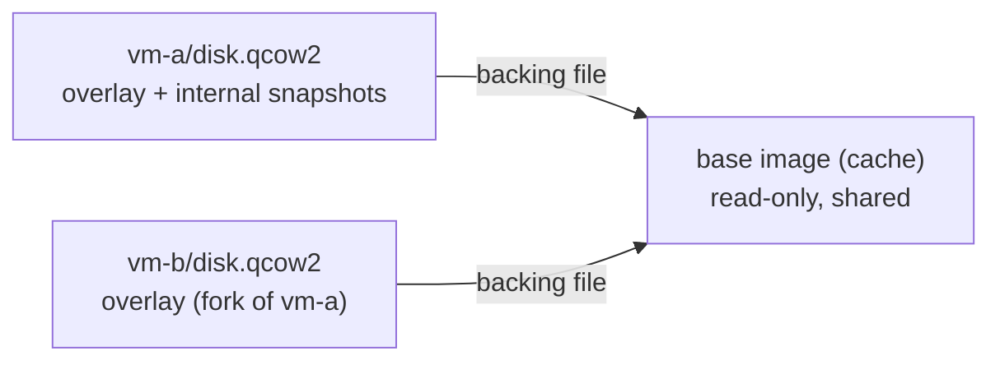
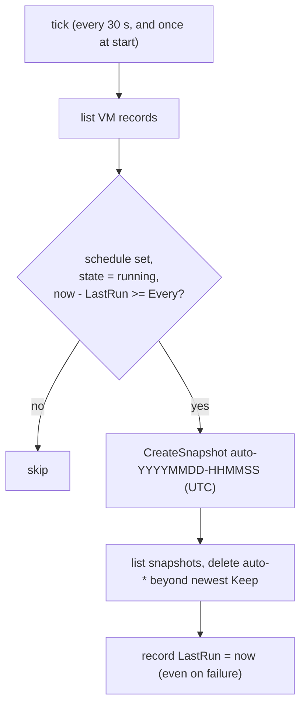
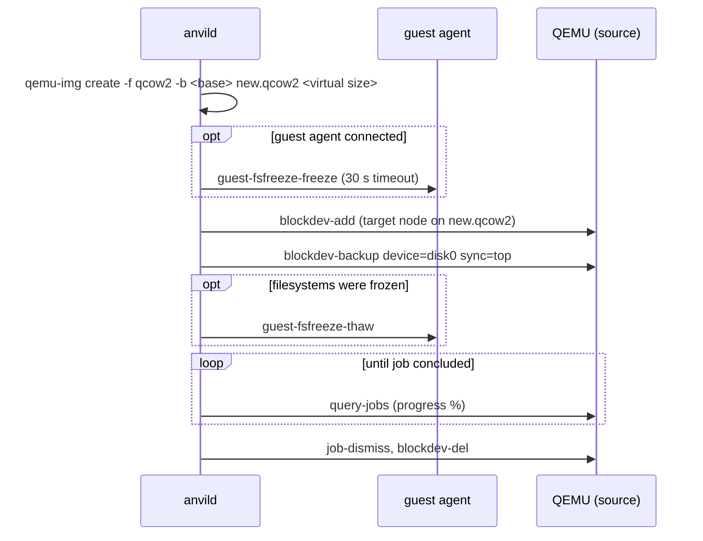

# Snapshots and fork

Two related operations work on a VM's disk image:

- `anvil snapshot` records named checkpoints *inside* a VM's own `disk.qcow2` and can
  roll the disk back to one of them later.
- `anvil fork` creates a *new* instance whose disk starts as a copy of an existing VM's
  disk.

Both are VM-only. Containers are covered at the end of this page.

## Background: the disk layout

Every VM disk created by `anvil launch` is a QCOW2 overlay (`<instance dir>/disk.qcow2`)
whose backing file is a shared, read-only base image from the image cache
(`internal/vm/backend.go`, `Create` calling `Vault.OverlayFor`). Reads of clusters the
overlay has never written fall through to the base image; writes always land in the
overlay. This two-layer chain is what both features build on:

- a snapshot is an entry in the overlay's own **internal** snapshot table, so it lives in
  the same file and never touches the base image;
- a fork is a second overlay on the **same** base image, so the base is shared rather
  than copied.



Anvil does not use external snapshots (a new overlay file per checkpoint). The only
backing chain is overlay to base image. The trade-off: internal snapshots keep one file
per VM and need no chain management, but they make that file grow with every
checkpoint, and restoring one needs exclusive access to the file (see below).

## `anvil snapshot`

Usage, from `internal/cli/commands/snapshot.go`:

```
anvil snapshot create   <instance> <snapshot-name>
anvil snapshot restore  <instance> <snapshot-name>
anvil snapshot delete   <instance> <snapshot-name>
anvil snapshot list     <instance>
anvil snapshot schedule <instance> --every <duration> [--keep N]
anvil snapshot schedule <instance> --off
```

The CLI only builds a request for the daemon's `SnapshotService`
(`internal/daemon/snapshot_server.go`), which calls `instance.Manager`
(`internal/instance/manager.go`). The manager type-asserts the backend against the
`instance.Snapshotter` interface (`internal/instance/backend.go`); a backend that does not
implement it gets the error `<kind> instances don't support snapshots`. The QEMU
implementation is in `internal/vm/backend.go`.

### Snapshot names

`checkSnapshotName` accepts only `^[A-Za-z0-9_.-]+$`. The restriction is not cosmetic:
the name is concatenated into a `qemu-img` argument and into the HMP command lines
`savevm <name>` / `delvm <name>`, so a space or a quote could change the command.
`create` also refuses a name that already exists on the disk (`already has a snapshot
named ...; delete it first`), even though `savevm` itself would silently overwrite it.

### Live versus offline

Whether an operation runs live depends on whether the backend has a QEMU process with a
QMP connection for that instance in its in-memory process table (`b.running`).

| Operation | VM running (QMP available) | VM stopped |
|---|---|---|
| create | HMP `savevm <name>` through QMP `human-monitor-command` | `qemu-img snapshot -c <name> disk.qcow2` |
| delete | HMP `delvm <name>` through QMP `human-monitor-command` | `qemu-img snapshot -d <name> disk.qcow2` |
| restore | stop the VM, `qemu-img snapshot -a <name> disk.qcow2`, start the VM | `qemu-img snapshot -a <name> disk.qcow2` |
| list | `qemu-img info -U` (read-only open) | same |

Why the split:

- A running QEMU holds a write lock on `disk.qcow2`, so `qemu-img` cannot modify it.
  Creating and deleting a live snapshot therefore has to go through the QEMU process
  itself. `savevm` and `delvm` are HMP (human monitor) commands, sent through QMP's
  `human-monitor-command` (`internal/vm/qemu/qmp.go`, `SaveVM`, `DeleteVMSnapshot`).
- HMP output is free text and not reliably parseable, so its content is not trusted.
  After a live create or delete, `verifySnapshotPresence` re-reads the disk's snapshot
  table with `qemu-img info -U` and fails if the snapshot is not (or is still) present.
- QMP also has a structured `snapshot-save` job. `QMPClient.SnapshotSave` exists but
  only returns "not yet implemented" (it needs stable `-drive` node names), so the HMP
  path is the one in use.
- `list` works in both states because `qemu-img info -U` opens the image without taking
  the lock (`internal/vm/image/vault.go`, `ListSnapshots`). The result is sorted oldest
  first.

### What a snapshot contains

`savevm` stores the disk state *and* the full VM state (RAM and device state) in the
snapshot. `qemu-img snapshot -c` stores the disk state only. `ListSnapshots` tells them
apart by the `vm-state-size` field: non-zero means `HasVMState`. `anvil snapshot list`
prints this as a third column:

```
<name>                         <RFC3339 time>       disk+VM state | disk-only
```

Two consequences follow from `savevm` including RAM:

- the VM is paused while its memory is written out, so a live snapshot of a VM with a
  lot of RAM causes a visible pause (the `schedule` help text says the same);
- the snapshot occupies roughly the guest's RAM size inside `disk.qcow2`, on top of the
  disk clusters it pins.

### Restore semantics

`RestoreSnapshot` in `internal/vm/backend.go` always resets the **disk only**. It never
resumes the saved VM state, even when the snapshot has one. The reason is the file lock:
`qemu-img snapshot -a` cannot open a disk that a running QEMU holds, so a running VM is
stopped first (graceful stop, 30 s timeout), the snapshot is applied, and the VM is
started again with a normal cold boot from the restored disk.

Failure handling:

- if the stop fails, nothing is applied and the error is returned;
- if the apply fails on a VM that was running, the VM is still restarted (on the old
  disk), and the error reports both failures if the restart also fails;
- a stopped VM stays stopped after a restore.

Trade-off: a cold boot is slower than resuming RAM state and loses in-memory work, but it
avoids restoring a guest whose clock, network leases and open connections are suddenly
in the past.

### Guest filesystem consistency

Snapshot creation does **not** freeze guest filesystems through the guest agent. A live
snapshot is still a coherent point in time, because `savevm` captures disk and RAM
together while the VM is paused; restoring the disk alone and cold-booting then looks to
the guest like a power loss at that instant, which journaling filesystems recover from.
The guest-agent freeze is only used by `anvil fork` (next section).

### Scheduled snapshots

```
anvil snapshot schedule <instance> --every 6h --keep 7
anvil snapshot schedule <instance> --off
```

Flags (`internal/cli/commands/snapshot.go`): `--every` (a Go duration, required unless
`--off`), `--keep` (default 7), `--off`. The CLI sends the interval in whole seconds.

Rules enforced in `SetSnapshotSchedule` (`internal/instance/schedule.go`):

- VM instances only, and the backend must implement `Snapshotter`;
- an interval of 0 removes the schedule (this is what `--off` sends);
- the interval must be at least `MinSnapshotInterval` (1 minute);
- `keep` must be at least 1;
- changing an existing schedule keeps its `LastRun` time.

The schedule is stored in the instance's record in bbolt
(`VMSpec.SnapshotSchedule`: `Every`, `Keep`, `LastRun`, in `internal/instance/spec.go`),
not in the disk image.

#### Where and how it runs

The scheduler is a goroutine inside `anvild`, started in `cmd/anvild/main.go` with
`go mgr.RunSnapshotScheduler(ctx)` after the gRPC server begins serving. There is no
systemd timer or cron entry.



Details from `RunSnapshotScheduler`, `runDueSnapshots` and `takeScheduledSnapshot`:

- **Tick.** The check runs once immediately, then every 30 seconds (`schedulerTick`). A
  snapshot is therefore taken up to about 30 s after it becomes due.
- **Running VMs only.** A VM whose recorded state is not `running` is skipped, since its
  disk does not change. When it starts again, a snapshot is taken on the next tick if the
  interval has elapsed since `LastRun`.
- **Live.** Because the VM is running, the snapshot goes through `savevm`, so every
  scheduled snapshot carries VM state and pauses the VM briefly.
- **Naming.** `auto-` plus the UTC time as `20060102-150405`. The 1-minute minimum
  interval keeps these names unique.
- **Pruning.** After a successful create, only snapshots whose name starts with `auto-`
  are considered. They are sorted by creation time and all but the newest `Keep` are
  deleted, oldest first. Hand-made snapshots are never pruned, *unless* their name also
  starts with `auto-`.
- **Failure.** `LastRun` is recorded even when the snapshot or the pruning fails, so a
  broken VM is retried once per interval instead of every 30 s. The error goes to the
  daemon log only.
- **No overwrite race.** `markSnapshotRun` re-reads the record before writing `LastRun`,
  so a schedule changed while a snapshot was being taken is not overwritten.
- **Serial.** Due VMs are handled one after another within a tick.

#### Daemon restarts

`LastRun` is persisted, so a restart does not reset the interval. The scheduler checks
right away on startup, and a VM that became due while the daemon was down gets **one**
catch-up snapshot, not one per missed interval. Nothing runs while the daemon is down.

## `anvil fork`

Usage, from `internal/cli/commands/fork.go`:

```
anvil fork <instance> <new-name> [--start]
```

`--start` boots the fork right after it is created; without it the fork is left
stopped. Progress is streamed (`InstanceService.Fork` returns `stream LaunchProgress`)
and printed like `anvil launch`.

### What is copied

`Manager.Fork` (`internal/instance/manager.go`) checks the backend implements
`instance.Forker`, rejects a `<new-name>` already in use, and builds a new record with a
fresh ID. `cloneVMSpecForFork` copies the VM configuration and clears everything tied to
the source's identity or network:

| Carried over | Reset |
|---|---|
| image ref, arch, CPUs, memory, `DiskGiB` | disk and seed ISO paths |
| cloud-init config, SSH public keys | SSH port |
| port mappings, mounts (same host paths) | network mode (forced to `slirp`) |
| labels | bridge interface, static IP, gateway, extra hosts, DNS servers and search |
| other `VMSpec` fields, including the snapshot schedule | source-disk adoption fields |

The fork does not become a member of the source's intent: membership is recorded on the
intent itself, and the bridge addressing that comes with it is cleared. The fork is
always a standalone SLIRP instance. Labels are still copied as-is, so a fork of an intent
member keeps the source's `intent` and `role` labels even though it is not a member.
One visible effect: `anvil export <fork>` refuses it as a member of that intent
(`internal/export/manager.go` checks the `intent` label).

Because the fork gets a new instance ID, its cloud-init seed is rebuilt
(`buildSeed`) with `instance-id: <new id>-gen<N>` and `local-hostname: <new-name>`, and
its MAC address is derived from the new ID. Cloud-init on the copied disk therefore sees
a new instance.

The copied disk keeps the source's **current** state only. Neither copy path
(`qemu-img convert`, `blockdev-backup`) carries the source's internal snapshot table, so
the fork starts with no snapshots.

### Disk copy: stopped source

`Backend.Fork` (`internal/vm/backend.go`) first reads the source's backing file and
refuses to fork a disk that has none (`has no backing file to preserve`). For a stopped
source it runs:

```
qemu-img convert -U -O qcow2 -o backing_file=<base>,backing_fmt=qcow2 <source disk> <new disk>
```

The output is a new overlay on the same base image, not a flattened copy, so the fork
only stores its own data, like a freshly launched VM. `-U` lets `qemu-img` open the
source even if some QEMU process outside anvil's knowledge holds it locked.

### Disk copy: running source

A running source is copied live by `forkLive` (`internal/vm/fork_resize.go`):



Why this works: `blockdev-backup` fixes the copy's point in time at the moment the job
starts. When the guest later writes to a cluster that has not been copied yet, QEMU
copies the old content to the target first (copy-before-write). The source keeps running
the whole time, and the freeze only has to last until the job has started, which is why
the thaw is sent immediately after `StartTopBackup` rather than after the copy finishes.

`sync=top` copies only the clusters allocated in the source's top layer (its overlay).
Combined with a target that already points at the same base image, the result is again
an overlay that shares the base.

Consistency levels, as reported in the progress stream:

- **filesystem-consistent**: the guest agent was connected and `guest-fsfreeze-freeze`
  succeeded, so all guest filesystems were flushed and quiesced at the copy point;
- **crash-consistent**: no agent, or the freeze failed (the progress line says
  `could not freeze guest filesystems (...), copy is crash-consistent`). The fork's disk
  then looks like the source after a sudden power loss.

A thaw failure is only logged; the fork itself still proceeds. On any error the partial
new disk is removed. If `--start` was given and the fork fails to boot, the new instance
is deleted again; the same happens if writing its record to bbolt fails.

### Interaction with disk resize

`anvil set <name> --disk <GiB>` grows a disk (`ResizeDisk` in
`internal/vm/fork_resize.go`, offline with `qemu-img resize`, live with QMP
`block_resize`) and updates `DiskGiB`. A fork inherits the grown size in both paths:
the live path creates the target with the source's current virtual size, the offline
`qemu-img convert` keeps it, and `DiskGiB` is copied in the spec. Inside the guest, the
partition and filesystem state is whatever was on the source disk at the copy point; if
the source had not grown its filesystem yet, the comment in `ResizeDisk` notes that
cloud-init's `growpart` and `resizefs` run on every boot and grow it then. The disk can
only grow, never shrink.

## Containers

Neither feature is available for containers:

- the Docker backend implements neither `Snapshotter` nor `Forker`, so the manager
  returns `container instances don't support snapshots` / `... don't support fork`;
- `snapshot schedule` rejects non-VM instances explicitly
  (`snapshot schedules only apply to VMs`);
- the TUI hides containers from the Snapshots screen and the fork key does nothing on a
  container.

The interface comment states the reason: a container has no equivalent primitive to a
QCOW2 internal snapshot. For containers, `anvil export` (see `export-import.md`)
captures the spec and bind-mounted volume data, which is the closest available
operation.

The darwin `vz` backend (`internal/vm/vz/backend.go`) implements both interfaces only as
stubs that return "not implemented".

## TUI

Snapshots screen (`internal/tui/snapshots.go`): a list of VM instances on the left and
the selected VM's snapshots on the right, with the current schedule
(`every 6h0m0s, keep 7, last 01-02 15:04`) shown above the snapshot list.

| Key | Action |
|---|---|
| `tab` | switch focus between the instance list and the snapshot list |
| `n` | new snapshot (prompts for a name) |
| `S` | set the schedule: `Every` (empty or `0` removes it) and `Keep` (default 7) |
| `a` / `enter` | restore the selected snapshot (snapshot list focused, asks `y` to confirm) |
| `d` | delete the selected snapshot (snapshot list focused, asks `y` to confirm) |
| `r` | refresh |
| `esc` / `q` | back to the sidebar |

Instances screen (`internal/tui/instances.go`): `f` on a VM opens a form with
`New name` and a `Start immediately` toggle, then streams the fork progress.

## Summary of trade-offs

- Internal snapshots: one file, no chain to manage, cheap to create; but they grow the
  overlay, live ones include RAM, and restore requires a stop and a cold boot.
- Scheduled snapshots run inside the daemon with a 30 s resolution and only for running
  VMs; at most one catch-up snapshot after downtime.
- Fork shares the base image instead of flattening, so it is cheap in space, and the
  live path gives a point-in-time copy without stopping the source; filesystem
  consistency depends on the guest agent being connected.
